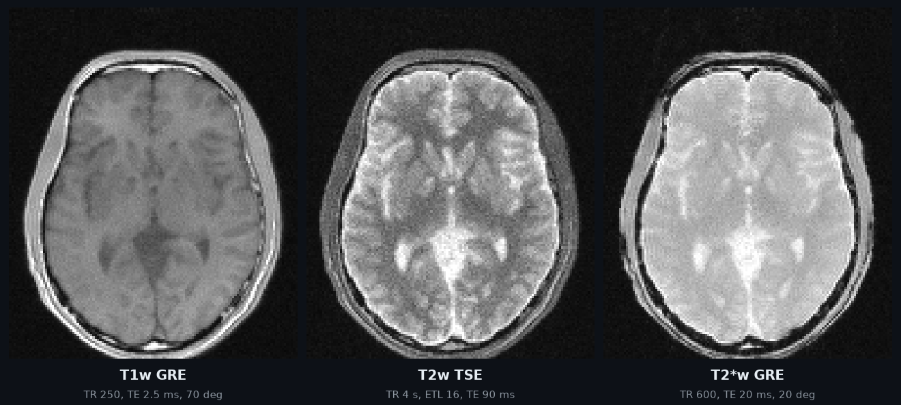
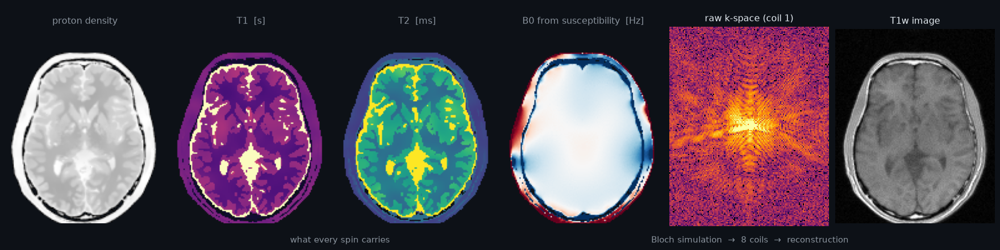
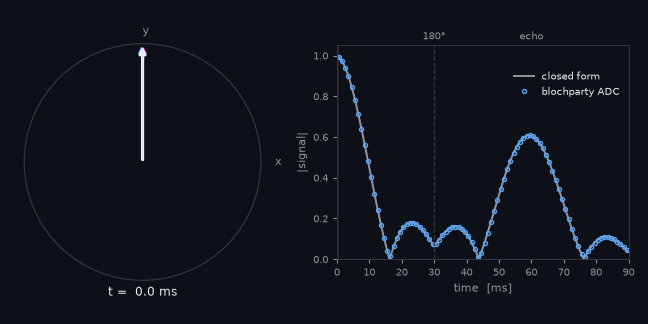
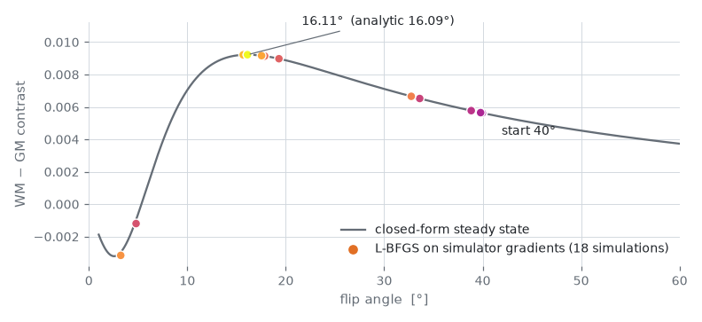
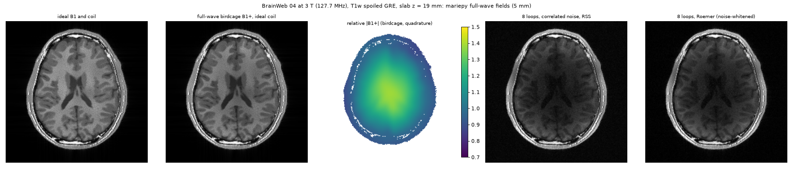

<p align="center">
  
</p>

<h1 align="center">Bloch Party 🎉</h1>

<p align="center">
  <b>A differentiable MRI simulator in PyTorch, checked against real scanners.</b><br>
  <i>Everyone's invited, as long as they precess.</i>
</p>

<p align="center">
  <a href="https://github.com/jonatanferm/blochparty/actions/workflows/ci.yml"></a>
  
  
  
  
  
</p>

Phantom + coils + sequence → raw k-space. Bloch Party simulates every spin through every RF pulse, gradient and
ADC sample of a sequence, and every number along the way (flip angles, timings, gradient waveforms, T1/T2/PD and
field maps, coil sensitivities, the scanner's own imperfections) can be a tensor with `requires_grad=True`.
The simulated head above is 9.7 million spins, with the real sequences' sinc pulses, ramps, spoiling and slice
profiles, imaged through an 8-channel coil array on a laptop GPU.

<p align="center">
  
</p>

## What's at the party

|  |  |
|---|---|
| **Differentiable, end to end** | Autograd through the PyTorch reference, and a hand-written adjoint on the GPU: gradients reach the sequence, the tissue, the coils and the hardware model. Optimize a sequence, fit a scanner, train through the physics. |
| **Fast** | One GPU driver for Apple Metal and NVIDIA CUDA (same device code). A 3D 64³ GRE runs in 0.5 s on an RTX 4090; full 3D 128³ in ~3 min on an M4 laptop. |
| **Realistic physics, opt-in** | Sub-voxel isochromats, T2′, B0 from tissue susceptibility, B1⁺, 6-peak fat, magnetization transfer (rate model and generalized Bloch), CEST pools, diffusion (free and restricted), flow and motion, J-coupling. |
| **Realistic hardware** | Concomitant (Maxwell) fields, gradient nonlinearity, GIRF and eddy currents, B0 drift and respiration, full-wave coil fields, correlated receive noise. All differentiable in the hardware parameters. |
| **Real sequences in, real data out** | Lossless Pulseq read *and* write (`.seq` files a scanner can play), sampled BrainWeb heads with cited tissue tables, ISMRMRD HDF5 output with full provenance. |
| **Checked, every feature** | Against closed forms, a SciPy ODE solver, EPG, the signal equation, MRzero, and raw data from real scanners. Defaults stay bit-identical; ~1000 tests. |

## Quick start

```bash
git clone https://github.com/jonatanferm/blochparty && cd blochparty
uv sync                                     # or: pip install -e .
uv run python examples/gre_demo.py          # 8-coil GRE of Shepp-Logan -> outputs/gre_demo.png
```

```python
import blochparty as bp

phantom = bp.shepp_logan(64)
coils = bp.birdcage_sensitivities(phantom.pos, n_coils=8)
seq = bp.gre_2d(64, flip_deg=15.0, tr=10e-3, n_dummy=200)

kspace = bp.simulate(phantom, seq, coils).signal          # (coils, n_adc) complex
image = bp.rss(bp.ifft2c(bp.kspace_grid(kspace, seq)))
```

3D works the same way: `bp.shepp_logan(32, ndim=3)`, `bp.gre_3d(32)`, `bp.reconstruct(...)`. Add
`engine="gpu"` to any `simulate` call to run it on Metal or CUDA.

<details>
<summary>More commands: tests, examples, benchmarks</summary>

```bash
uv sync --extra pulseq --extra mrzero --extra io --extra anatomy   # everything optional
uv run pytest                              # the full suite, ~4 min on an M4 (GPU tests skip without a GPU)
uv run pytest -m "not slow"                # the quick subset, under a minute
uv run python examples/optimize_contrast.py  # gradient descent through the simulator (--gpu: the GPU adjoint)
uv run python examples/gre3d_128.py        # full 3D 128^3 on the GPU, ~3 min on an M4
uv run python benchmarks/bench.py          # timed 2D/3D workloads (--record to log)
uv run python benchmarks/bench.py --grad --backend gpu  # forward + backward through the GPU adjoint
uv run python tools/readme_figures.py      # this README's figures
```

</details>

## Spins, simulated

<p align="center">
  
</p>

A spin echo, as Bloch Party sees it: 36 isochromats spread over 60 Hz fan out after a 90°ₓ pulse, a 180°ᵧ
pulse at 30 ms mirrors them, and they refocus at TE = 60 ms. The arrows are the simulator's magnetization at each
frame; the dots are its ADC samples, on top of the closed form (agreement to 2e-3, set by the 50 µs hard pulses).
A case with a known answer, so you can see the simulator is right; the real sequences [below](#against-real-scanners)
have none, and that is where it earns its keep.

## Gradients through the whole scanner

<picture>
  <source media="(prefers-color-scheme: dark)" srcset="docs/images/optimize_flip_dark.png">
  
</picture>

L-BFGS on gradients through the Bloch simulation *and* the reconstruction finds the flip angle that maximizes
white/grey-matter contrast in a simulated spoiled GRE: 16.11° in 18 simulations, against 16.09° from the
closed-form steady state ([`examples/optimize_contrast.py`](examples/optimize_contrast.py)).
[`blochparty.design`](#sequence-design) builds on this: hardware and safety constraints (gradient, slew, B1, SAR,
PNS) with smooth penalties, CNR / SNR / PSF metrics, Cramér–Rao bounds, and a constrained optimizer.

## Against real scanners

Simulators are usually validated against closed forms and each other. Bloch Party also runs the **scanner's own
`.seq` files** on a digital model of the scanned object, with properties from independent references and
**nothing fitted**, and compares with the raw data the scanner measured
([validation/real/](validation/real/), [docs/REALISM.md](docs/REALISM.md)).

<p align="center">
  
</p>

The ISMRM/NIST phantom on a 3 T Siemens Prisma, inversion-recovery spin echo, 14 spheres: simulating the actual
sequence (sinc pulses and their slice profiles, crushers, spoilers, real timing) matches the measured curves to
**1.3 %**, where the analytic inversion-recovery formula misses by ~20 % ([results](validation/real/RESULTS.md)).
Other benchmarks cover multi-echo TSE, radial IR-bSSFP, CEST z-spectra, MT in BSA and a spiral TSE.

## Heads, sampled

<p align="center">
  
</p>

`bp.sample_head(seed)` returns a new head for every seed: a BrainWeb subject, smoothly deformed, with its own
tissue draws from a cited table (relaxation, MT, diffusion, susceptibility) and its own texture, ready to be
scanned and written out as ISMRMRD raw data with full provenance. With full-wave coil fields, the transmit field
and receive array come from Maxwell's equations too:

<p align="center">
  
</p>

## Documentation

Every feature is checked against an independent reference (the record: [docs/ROADMAP_ARCHIVE.md](docs/ROADMAP_ARCHIVE.md);
the plan: [ROADMAP.md](ROADMAP.md)). What other simulators do and the realism plan: [docs/REALISM.md](docs/REALISM.md);
which engine runs what: [docs/ENGINES.md](docs/ENGINES.md); hard-won lessons: [docs/LESSONS.md](docs/LESSONS.md);
the project journal: [docs/JOURNAL.md](docs/JOURNAL.md).

Anything numeric in a sequence or phantom can be a tensor with `requires_grad=True`
(flip angles, TR, gradient amplitudes, T1/T2/PD/B0/B1⁺/T2′/fat maps, coil maps).

## Engines

One entry point, `bp.simulate(phantom, seq, coils, ..., engine=)`, with the same arguments and result for
every engine, and one physics. Which features each engine runs, with forward and gradients, is the matrix in
[docs/ENGINES.md](docs/ENGINES.md), checked cell by cell by `tests/engines/test_engines.py`;
`bp.engines.available(engine)` says what runs on this machine.

- `engine="core"` (the default): the reference. Plain PyTorch on any device, float32 or float64,
  differentiable by autograd. Every new effect lands here first.
- `engine="metal"` (`blochparty.metal.simulate_metal`): the engine for imaging-scale work, on the Apple GPU. Float32.
  Runs everything the core runs, free exchanging pools (CEST, up to five) included, except free
  pools together with the generalized Bloch bound pool. For CEST / MT saturation that combination is
  not needed: the rate model with `BoundPool(cutoff=None)` (the generalized model's own lineshape,
  no near-resonance cut) equals the generalized model to 5e-5 on 50 ms pulses and runs on the GPU
  (ROADMAP M1c). Differentiable through a hand-written adjoint on the GPU (sequence, phantom, coils,
  `m_init`, rate-model bound pool, scanner field model; not moving spins or free pools).
- `engine="cuda"` (`blochparty.cuda.simulate_cuda`): the Metal engine on an NVIDIA GPU, with the same arguments,
  results, adjoint and limits (the same device code and driver; kernels compiled at run time by
  NVRTC). An RTX 4090 runs the 3D 64^3 GRE benchmark in 0.5 s, against 2.4 s for Metal on an M4.
- `engine="gpu"`: CUDA where an NVIDIA GPU is, else Metal. Scripts use this, so they run on either machine.
- `engine="chunked"` (`bp.simulate_chunked`): the core with a backward pass that holds one chunk of spins at a time,
  for gradients on large phantoms (no exchange, diffusion, motion, scanner model, `FieldMaps` or
  `m_init`).

The fused C++ CPU kernel (`simulate_fused`, float32 / float64 with a hand-written adjoint) was
retired on 2026-10-09 once the Metal adjoint passed its checks; it is in the git history.

```python
kspace = bp.simulate(phantom, seq, coils, engine="gpu").signal   # (coils, n_adc) complex64, back on the CPU
```

## Realistic phantoms

`phantom_from_maps` turns 2D/3D maps into spins; the options below are off by default (one
spin per voxel centre, results unchanged bit for bit):

```python
from blochparty.coils import birdcage_b1
from blochparty.phantom import b0_shim, b0_sphere

maps = bp.shepp_logan_maps(64)
grid = bp.grid_positions(64, 0.22).reshape(-1, 3)
air = b0_sphere(grid, (0.0, 0.07, 0.0), 0.01, 9.4e-6)    # 1 cm air pocket in tissue, Hz
b0 = (b0_shim(grid, z2=300.0) + air).reshape(64, 64)
phantom = bp.phantom_from_maps(
    maps["pd"], maps["t1"], maps["t2"], fov=0.22, db0=b0,
    spins_per_voxel=4, jitter="stratified", seed=0,   # 2x2 isochromats per voxel, PD / 4 each
    t2prime=torch.full((64, 64), 0.05),               # Lorentzian intra-voxel offsets: T2*
    fat_fraction=(maps["label"] == 1).double(),       # 6-peak fat spins in the "fat" ellipse
    field_strength=3.0,
    b1=birdcage_b1(grid, centre_brightening=0.3).reshape(64, 64))  # transmit scale
```

- **Sub-voxel isochromats** (`spins_per_voxel=K` or per-side counts like `(1, 8)`; regular
  sub-grid or `jitter="stratified"`; in-plane for 2D maps). Spins per voxel side must exceed the cycles of
  dephasing across a voxel that still carry signal (spoilers, stimulated echoes), else
  those configurations alias back as spurious echoes (`validation/mrzero/RESULTS.md`). Costs
  K× the spins; use `simulate_metal` (its adjoint) or `simulate_chunked` for gradients.
- **T2′** (`t2prime` map): each voxel's spins get static offsets from a Lorentzian of
  half-width 1/(2πT2′) (Cauchy quantiles shuffled over the voxel, or `t2prime_sampling="random"`),
  so the FID decays with 1/T2* = 1/T2 + 1/T2′ and a spin echo refocuses it. K spins
  reproduce exp(−t/T2′) to ~0.5/√K of the initial signal over the first few T2′ (needs
  hundreds of spins per voxel for percent accuracy).
- **B0 maps**: `b0_shim` (offset, linear and second-order solid harmonics), `b0_sphere` and
  `b0_cylinder` (closed-form susceptibility fields, Lorentz corrected, B0 along z) return
  Hz at any positions; evaluate them at `phantom.pos` to sample the field at every spin.
- **B1⁺**: `Phantom.b1` (`None` = 1) scales every RF pulse per spin (flip b1·α) in `simulate`,
  `simulate_chunked`, `simulate_metal` (forward and adjoint: `b1` gets gradients) and
  `reference.signal_equation`. `coils.birdcage_b1(pos, centre_brightening, radius)` is a CP
  birdcage field, uniform or with J0(kρ) centre brightening.
- **Fat** (`fat_fraction` map): water keeps PD·(1 − f); one fat spin per peak of `FAT_PEAKS`
  (−3.80 … +0.60 ppm, amplitudes normalised to 1) with PD·f·a_p, fat T1/T2 (`fat_t1`,
  `fat_t2`) and offset ppm·γ̄·B0 (`field_strength`, T): fat sits below water (−434 Hz for
  the main peak at 3 T). Fat spins share their water spin's position, T2′ offset and B1⁺.
  `bp.shepp_logan(n, chemical_shift=True)` turns its fat ellipse into fat.

### Sampled heads and raw-data files

`sample_head(seed, root=...)` returns a new head for every seed: a BrainWeb subject, smoothly
deformed, with its own tissue draws from the cited table (relaxation, MT, diffusion) and its own
texture; `head.meta` records every draw. `io.write_dataset` stores the result as ISMRMRD HDF5,
readable by Gadgetron or ismrmrd-python, with a `/provenance` group (sequence arrays and JSON,
the `.seq` file, the head's draws, seeds, engine, git commit, versions); `io.read_dataset` reads
it back. Both need the `io` extra (`uv sync --extra io`). `examples/sampled_heads.py` images ten heads
in three contrasts ([figure](validation/anatomy/sampled_heads.png)).

```python
from blochparty.io import write_dataset

head = bp.sample_head(7, root="validation/anatomy/data", voxel=(1e-3,) * 3)
k = round(-head.anatomy.origin[2] / head.anatomy.voxel[0])  # the z = 0 plane, where the slice is
ph = head.to_phantom(fov_region=(slice(k - 4, k + 5), slice(None), slice(None)))  # B0 from the whole head
seq = bp.gre_2d(64, ramps=True, spoiling="rf", slice_thickness=5e-3)
coils = bp.birdcage_sensitivities(ph.pos, 8)
write_dataset("head7.h5", bp.simulate(ph, seq, coils, engine="gpu"), seq, phantom=head, seed=7, engine="gpu",
              coils={"model": "birdcage", "n": 8})
```

## Realistic sequences

The default builders are idealised (hard pulse, instantaneous gradients, ideal spoiling) and
stay bit-identical. Opt in to the real versions, built within a `System`'s hardware limits
(default: 40 mT/m, 170 T/m/s, 10 µs gradient / 1 µs RF / 0.1 µs ADC rasters, 100 µs RF dead
time, 30 µs ringdown; gradients in Hz/m):

```python
from blochparty.builders import se_2d, tse_2d, bssfp_2d, epi_2d, cartesian_recon

seq = bp.gre_2d(64, spoiling="rf", ramps=True, slice_thickness=5e-3)  # or spoiling="gradient"
seq = tse_2d(64, etl=8, refocus_flip_deg=[150, 120, 120, ...], ordering="centric")
seq = bssfp_2d(64, flip_deg=50.0)          # alpha/2 prep, 180 deg phase cycling, TE = TR/2
seq = epi_2d(64)                           # single shot, blips on the readout ramps
image = bp.rss(cartesian_recon(bp.simulate(phantom, seq, coils).signal, seq))
```

- `spoiling="gradient"`: a spoiler lobe brings the net readout-axis moment per TR to
  `spoiler_cycles` (default 4) cycles across a voxel, phase encodes are rewound; `"rf"` adds
  quadratic RF spoiling (117°, receiver phase follows). Spoiling acts on intra-voxel dephasing,
  so it needs several isochromats per voxel: with one spin at each voxel centre the spoiler
  is a whole number of turns and RF spoiling only modulates the signal line by line (ghosts).
- `slice_thickness`: windowed-sinc pulse (`time_bw_product`, `apodization`, default 2 ms) with
  slice-select gradient, `slice_offset` via a frequency offset, rephasing lobe including the
  ramps. `ramps=True`: trapezoids (minimum time, as pypulseq designs them).
- `se_2d`, `bssfp_2d` (and GRE) set `meta["kspace_shape"]`, so `bp.reconstruct` works. `tse_2d`
  (line ordering) and `epi_2d` (alternating readouts) set `meta["matrix"]` and
  `meta["kspace_index"]` instead; `cartesian_kspace` / `cartesian_recon` work for all of them.
- Building blocks for your own sequences (`blochparty.sequence`): `trapezoid(...)` (by area,
  flat area or amplitude; any axis or direction), `gradient_waveform(samples, raster)`,
  `block_pulse`, `sinc_pulse`, `ADC`, and `SequenceBuilder.block(*gradients, rf=..., adc=...)`,
  which plays them together like a Pulseq block. Ramps are cut on the gradient raster and each
  segment carries its exact average gradient, so k-space is exact at every ADC sample. Limits
  are checked (per axis) and violations raise.

## Pulseq

`read_pulseq` turns a `.seq` file (or a `pypulseq.Sequence`) into a `Sequence`, and
`write_pulseq` writes one back (both need the `pulseq` extra: `pip install 'blochparty[pulseq]'`;
`uv sync` installs it for development):

```python
from blochparty.pulseq import read_pulseq

seq = read_pulseq("gre.seq", kspace_shape=(64, 64))   # extra keywords go to seq.meta
kspace = bp.simulate(phantom, seq, coils).signal
seq.meta["adc_per_readout"], seq.meta["kspace_trajectory"]  # samples per ADC; k from pypulseq

from blochparty.pulseq import write_pulseq
write_pulseq(bp.gre_2d(64, ramps=True, spoiling="rf", slice_thickness=5e-3), "gre.seq")  # for the scanner
```

- Blocks are split at every event boundary, so each ADC sample ends a segment; gradients use
  the exact average over each segment, so k-space matches pypulseq's `calculate_kspace` to
  ~1e-10. Shaped RF, trapezoids, arbitrary and extended gradients, delays, frequency and phase
  offsets (including ppm), ADC phase modulation. Labels and triggers are ignored; other
  extensions (rotations, RF shims) raise.
- Phases: Pulseq phase φ gives Mxy = i·e^{−iφ}·sin α (a real pulse still tips +z to +y), so
  that a frequency offset f excites the slice at f/G as Pulseq defines it. MRzero reads the
  phases as written: `read_pulseq(..., convention="mrzero")` does the same (the mirror image).
- Pulseq cannot express ideal spoiling; set `seq.spoil[i] = True` after import if wanted.
- Files are read with every number as written (pypulseq's default merges events after rounding
  amplitudes to six digits and timings to 1 µs; the scanner files in `validation/real` read
  identically either way).
- `write_pulseq` is lossless: written and read back, GRE (ramps, slice selection, RF spoiling),
  TSE, bSSFP and EPI simulate identically to 1e-9, pypulseq's `check_timing` passes and k-space
  equals its `calculate_kspace` (`tests/sequences/test_pulseq_write.py`). It writes Pulseq 1.5 itself at
  full precision (pypulseq's writer keeps six digits), one Pulseq block per `SequenceBuilder.block`
  call (the builder records them in `seq.meta["blocks"]`; an EPI train's block is cut between its
  ADCs). It raises for what a scanner cannot play: ideal spoilers (`spoil="drop"` writes without
  them), the ideal `rf` / `readout` calls and instantaneous gradients (use `ramps=True` builders),
  timings off the rasters, and sequences changed after building (e.g. by `apply_girf`: write the
  nominal sequence). Imported files are written back from their own events.
- Cross-validation against MRzero: `uv sync --extra mrzero`, then
  `uv run python validation/mrzero/compare_mrzero.py` (writes [validation/mrzero/RESULTS.md](validation/mrzero/RESULTS.md))
  or `uv run pytest -m crosscheck`.

## Scanner field model

Real gradients are not ideal. All of this is opt-in (`scanner=None`, no `b0_offset`: results
unchanged bit for bit), runs in `simulate` and `simulate_metal` (forward and adjoint), and is
differentiable in the hardware parameters, so a scanner's imperfections can be fitted:

```python
from blochparty.fields import GradientNonlinearity, Scanner
from blochparty.girf import GIRF, EddyCurrents, apply_girf
from blochparty.drift import linear_drift, respiration

scanner = Scanner(field_strength=0.55,                      # concomitant fields (leading order)
                  nonlinearity=GradientNonlinearity.from_file("coil.grad"))  # gradunwarp-style
played = apply_girf(seq, [GIRF.identity(delay=[2e-6, 2e-6, 3e-6]),            # per-axis delays
                          EddyCurrents.per_axis([[0.01], [0.01], [0.02]], [[0.5e-3]] * 3,
                                                b0_amplitude=[[1e-5]] * 3, b0_time_constant=[[1e-3]] * 3)])
played = respiration(linear_drift(played, rate=0.01), amplitude=3.0, period=4.0, gradient=(0.0, 20.0, 5.0))
kspace = bp.simulate(phantom, played, coils, scanner=scanner).signal
```

- **Concomitant (Maxwell) fields** (`Scanner(field_strength=B0)`): the transverse field
  components a cylindrical coil must have (div B = curl B = 0) shift the precession
  frequency by f_c = [(gx² + gy²) z² + gz² (x² + y²)/4 − gx gz xz − gy gz yz] / (2 f0)
  (Bernstein; `z_asymmetry` for asymmetric z coils). It is a per-spin quadratic form in g, so
  free runs stay closed form (cumulative ∫gᵢgⱼ dt). `concomitant="exact"` uses |B| of the full
  vector field instead (very low field, checks). Ramps on the raster are staircases: their
  ∫g² is low by (step)²·dt/12 per segment.
- **Gradient nonlinearity** (`GradientNonlinearity(alpha, beta, r0)` or `.from_file`):
  per-axis solid-harmonic deviation of each coil (gradunwarp's Siemens convention, `.grad`
  `A( n, m)` lines or `alpha_x n m` lines); spins are encoded at f(r) = r + d(r). Gradients reach
  the coefficients.
- **GIRF and eddy currents** (`apply_girf(seq, model)`, a sequence transform): `GIRF` impulse
  responses (taps on the gradient raster, or `from_transfer_function`, with delays and cross
  terms, row 4 = B0), `EddyCurrents` multi-exponential terms (amplitudes and time constants
  differentiable, B0 terms included). Each segment gets the exact average of the response to
  the nominal staircase, so k-space is exact at every segment end.
- **Uniform field per segment**: `Sequence.b0_offset` (S,) [Hz] (None = zeros) adds to every
  spin's off-resonance, also during RF; B0 eddy currents and drift land there.
- **Drift and physiology** (`blochparty.drift`): `linear_drift`, `exponential_drift`,
  `respiration` (uniform + linear terms with a period) add exact segment averages to
  `b0_offset` and (for linear fields) to the gradients.

## Memory-bounded gradients

Backprop through `simulate` keeps every spin's state at every segment, so memory grows as
spins × segments. When that no longer fits, swap in `simulate_chunked`: same arguments
and result, but the backward pass recomputes the simulation one spin chunk at a time, so
the graph it holds covers only `spin_chunk` spins.

```python
from blochparty.chunked import simulate_chunked

kspace = simulate_chunked(phantom, seq, coils, spin_chunk=4096).signal
loss(kspace).backward()            # same gradients as with simulate (to ~1e-12 in float64)
```

- Use it for gradients on large phantoms (3D, sub-voxel spins); plain forward runs gain
  nothing from it. It costs about one extra forward pass (~1.5× `simulate` forward+backward)
  plus a fixed per-segment Python cost per chunk, so keep chunks in the thousands of spins.
- `checkpoint_every` bounds the other direction (segments) and combines with it.
- Autograd also keeps a few tens of kB of bookkeeping per segment regardless of spin count,
  so for long sequences that floor, not the chunk, sets the minimum memory.
- First-order gradients only (no double backward).

## Fast gradients: the GPU adjoint

The GPU engines (`engine="gpu"`, `"metal"`, `"cuda"`) are differentiable through a hand-written adjoint
on the GPU instead of autograd (float32):

```python
kspace = bp.simulate(phantom, seq, coils, engine="gpu").signal   # compiles the kernels on first use
loss(kspace).backward()            # the core's gradients to ~1e-6 .. 1e-4 (float32)
```

- Gradients reach the sequence (`dt`, `rf`, `grad`, `adc_phase`, `b0_offset`, `rf_freq`), the
  phantom (`pos`, `pd`, `t1`, `t2`, `db0`, `b1`), the coils, `m_init`, the rate-model bound pool,
  the scanner field model and static `FieldMaps`; moving spins, free pools and the generalized
  bound pool raise (the core differentiates those).
- The forward stores every spin's state each `checkpoint_every` segments (a multiple of 64,
  default ≈ √segments); the backward replays one interval at a time and sweeps it in reverse.
  Results are bit-identical for any `checkpoint_every` and from run to run (no atomics).
- Forward + backward costs ~5-7 forward passes (3D GRE, 8 coils), with no autograd graph.
- First-order only (no double backward): a Cramér–Rao bound through it takes its Jacobian by
  finite differences (`design.crb(..., method="fd4")`).

## Sequence design

`blochparty.design` adds what an optimizer (or an agent) needs around the simulator. Everything
is a differentiable function of the sequence's tensors or of simulated images:

```python
from blochparty import design

hw = design.Hardware(max_grad=40, max_slew=150, max_b1=20)   # mT/m, T/m/s, µT
loss = -design.cnr(image, wm, gm, sigma) + sum(design.penalties(seq, hw).values())
var = design.crb(signal_fn, theta)   # Cramér–Rao bounds from the simulated Jacobian
report = design.design_report(seq, phantom, masks=masks, contrast_pairs=[("wm", "gm")], kspace_sigma=0.05)
report["violations"]  # ["slew x exceeded at 128 boundaries (128 ranges); worst at boundary 402 (t = 2002.685 ms) by 699 % ...", ...]
```

- Constraints, in scanner units: gradient amplitude [mT/m] and slew [T/m/s] per axis, peak
  B1 [µT] (Hz → T via γ̄), RF energy Σ|B1|²·dt and a SAR proxy (mean |B1|², optionally scaled
  and windowed), an approximate PNS estimate (chronaxie-filtered dG/dt; reproduces the IEC
  hyperbolic strength–duration law, but is not a coil-specific model), scan time. Each has a
  smooth penalty (`penalties`) and violation reports naming segment ranges, times and excess.
- A gradient step is taken to ramp over at most one gradient raster time (10 µs): ramps sampled
  on the raster (as `read_pulseq` does) give their true slew, while the builders' instantaneous
  gradients show up as violations instead of being hidden by long segments.
- Metrics: tissue contrast, CNR, SNR and SNR efficiency (noise σ given, or propagated from the
  coil noise model through any reconstruction by pseudo-replicas), PSF and its FWHM / sidelobes
  from a simulated point spin, and the Cramér–Rao bound with the Jacobian w.r.t. tissue
  parameters taken by autograd (`method="autograd"`, differentiable again through `simulate`) or
  central differences (`method="fd"`, or `"fd4"` for float32 engines; differentiable through
  `simulate_metal`).
- `minimize`: augmented Lagrangian around L-BFGS, so active constraints hold exactly at the end.
- `design_report`: JSON-serialisable timing, constraints with margins, PSF and image metrics.

Optimizations with independently known answers (each is also a test; they run through the core
in float64, DESPOT1 also through the GPU adjoint with `--gpu`):

```bash
uv run python examples/design_despot1.py     # VFA T1 mapping: CRB-optimal flips give 70.71 % of Ernst (Deoni 2003)
uv run python examples/design_contrast_tr.py # WM/GM contrast, flip and TR free under a scan-time budget
uv run python examples/design_tse_flips.py   # low-SAR TSE refocusing train, echoes >= target (vs EPG + SLSQP)
uv run python examples/design_report.py      # the report for an 8-coil GRE -> outputs/design_report.json
```

## Layout

<!-- layout: generated by tools/layout.py from the module docstrings -->
| module | contents |
|---|---|
| `anatomy/` | Anatomies on a physical grid (BrainWeb, QSM, AHEAD and IXI heads with cited tissue properties), the head sampler and its edits, and sub-voxel spins from them. Modules: `ahead`, `brainweb`, `deformation`, `edits`, `grid`, `ixi`, `phantom`, `qsm`, `sampler`, `tables`, `tissuedb`. |
| `coils.py` | Receive coil sensitivities and thermal noise. |
| `constants.py` | Physical constants shared across modules. |
| `design/` | Sequence design: hardware / safety constraints, image-quality metrics and losses, and a machine-readable design report. Modules: `estimation`, `hardware`, `metrics`, `optimize`, `parameters`, `problems`, `report`. |
| `em.py` | Full-wave coil fields into blochparty: B1+ maps, receive sensitivities and noise covariance. |
| `engines/` | How a simulation is run: `simulate(..., engine=)` (`blochparty.simulate`) on the PyTorch core, the chunked core or a GPU engine (Metal, CUDA). Modules: `capabilities`, `chunked`, `core`, `gpu`, `prepare`. |
| `epg.py` | Extended Phase Graph (EPG) reference model. |
| `exchange.py` | Magnetization transfer: a bound (semi-solid) pool exchanging with the free water. |
| `fields.py` | Scanner field model: what the spins see beyond the ideal B0 + G.r (REALISM.md, R1). |
| `generalized_bloch.py` | Generalized Bloch model of the semi-solid (bound) pool (Asslander et al., arXiv 2107.11000). |
| `generate/` | Training data (ROADMAP M7): a spec and a seed -> simulated samples with their truth, written with provenance. Modules: `heads`, `protocols`, `sample`, `spec`. |
| `io/` | Raw data in and out: simulated acquisitions as ISMRMRD HDF5 with full provenance (`ismrmrd`: write_dataset, read_dataset) and a minimal reader for Siemens twix files (`twix`). Modules: `ismrmrd`, `twix`. |
| `jcoupling.py` | J-coupled protons under spin-echo trains: density matrices for small coupled spin fragments (ROADMAP M6.1). |
| `loops.py` | Physically based coils: arrays of circular loops in the quasi-static limit. |
| `maps.py` | Scanner-frame field maps, sampled where each spin is. |
| `montecarlo.py` | Monte Carlo estimators for simulations repeated over independent random seeds (spin positions, walks): the debiased power and magnitude of K complex-image estimates, the leave-one-seed-out jackknife of any statistic, and scrambled Sobol points for quasi-Monte-Carlo spin placement. |
| `motion.py` | Moving spins: flow, periodic deformation and rigid motion. |
| `phantom.py` | Phantoms: collections of isochromats (spins) with tissue properties. |
| `receive.py` | The receive chain after the coils: what a scanner's electronics do to the signal. |
| `recon.py` | Reconstruction for Cartesian data: k-space gridding, centred FFTs, RSS and coil combination; and for undersampled data, line masks (uniform, variable-density, random) and CG-SENSE with given coil maps. |
| `reference.py` | Reference models used to validate the Bloch simulator. |
| `restriction.py` | Restricted diffusion: every spin walks inside its own impermeable compartment. |
| `result.py` | What a simulation returns, whichever engine ran it. |
| `rng.py` | Counter-based random numbers shared by every engine: Philox4x32-10 (Salmon et al., SC 2011). |
| `sequence.py` | Sequence representation: a flat list of piecewise-constant segments. |
| `sequences/` | Building sequences: the builder and its events (`builder`), ready-made sequences (`library`), the `Sequence.meta` keys (`meta`), Pulseq import and export (`pulseq`), and the hardware's effects on a sequence: gradient impulse responses and eddy currents (`girf`), B0 drift and respiration (`drift`), the RF amplifier (`transmit`). Modules: `builder`, `drift`, `girf`, `library`, `meta`, `pulseq`, `transmit`. |
| `susceptibility.py` | Scalar susceptibility -> Lorentz-corrected spin frequency, and low-order shimming. |
<!-- /layout -->

Tests live in `tests/<area>/`: `engines`, `physics`, `sequences`, `phantoms`, `signal`, `validation`, `design` and
`docs`; `uv run pytest tests/engines` runs one area. Cases shared between files are in `tests/cases.py`, the
comparison helpers in `tests/helpers.py`, and the `gpu` fixture (every GPU engine on this machine) in
`tests/conftest.py`.

## Conventions

- **Units (Pulseq-style):** RF in Hz (γ̄·B1), gradients in Hz/m (γ̄·G), off-resonance in Hz,
  time in s, position in m. Gradient area = k-space position in cycles/m.
- **Rotation:** dM/dt = γ M × B with γ > 0. A pulse along +x tips +z to +y; RF phase φ
  puts the magnetization at Mxy = i·e^{iφ}·sin α.
- **Signal:** Mxy = Mx + iMy evolves as e^{−i2πft} at offset f; s(k) = Σ ρ(r)·C(r)·e^{−i2πk·r};
  ADC phase ψ demodulates by e^{−iψ}.
- **Grid:** index i ↔ position (i − n/2)·FOV/n and k = (i − n/2)/FOV; arrays are ordered
  (z, y, x), so the last axis is x. 3D GRE lines run with ky fastest, then kz.
- **ADC timing:** sample i of a readout sits at (i + ½)·dwell after the ADC start (Pulseq).
- **Pulseq:** RF field = conj(Pulseq RF waveform), receiver phase = −(Pulseq ADC phase); see
  `blochparty/sequences/pulseq/` for why and for the MRzero mapping.
