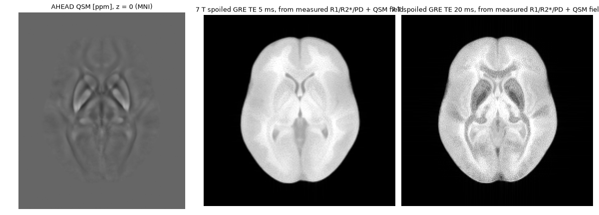
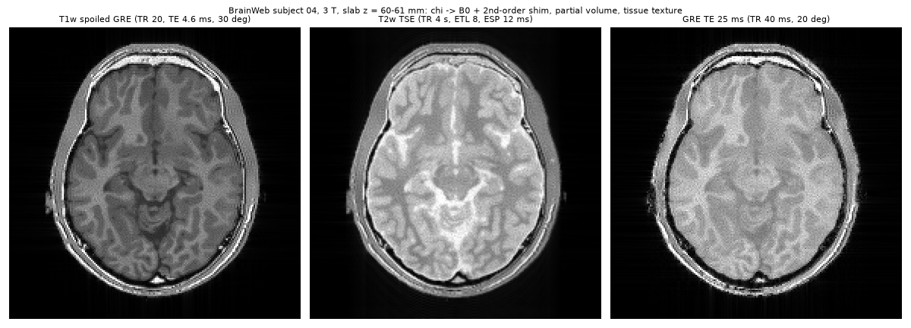
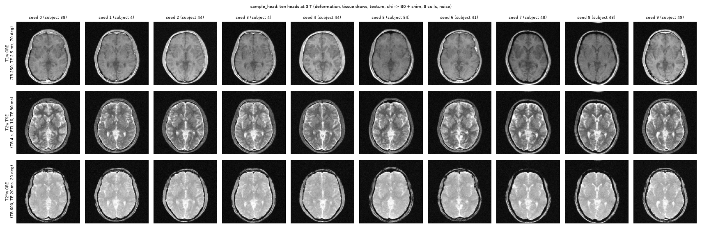

# Anatomy M2 results — 2026-10-07

M2 adds BrainWeb loading and tissue spin assembly without engine changes.
Full suite with Apple GPU access: **449 passed, 4 opt-in crosschecks deselected**
(185.08 s). Existing default output/gradient snapshots are **bit-identical**.

## Independent synthetic checks

`tests/phantoms/test_anatomy.py` contains 21 tests including parameterized cases.

| Check | Result |
|---|---|
| Per-tissue and per-voxel PD conservation | absolute error < 1e-12, float64; K=1, 8 and (1,2,3) |
| Resampled physical tissue volume | relative error < 1e-6; three nontrivial spacings, float32/64 |
| Mixed-tissue spoiled GRE vs Ernst closed form | maximum complex error < 1e-8 |
| Shifted continuous box vs analytic Fourier transform | maximum normalized error 0.177089, 0.00384746, 0.000230445, 0.0000143652 at 1,4,16,64 x samples/cell |
| Sphere susceptibility at jittered spin positions | RMS 0.464157 Hz vs independent `b0_sphere`, 3 T |
| Anatomical GPU vs core, B0 + MT + diffusion | maximum relative signal error 3.23e-7 |
| 4096 Cauchy quantiles vs exponential T2* FID | maximum complex error < 0.005 |

The box anatomy grid is offset 0.3 mm from a nominal reconstruction grid. Subcell
quadrature converges to its continuous, piecewise-constant density. This does not
prove that fuzzy memberships recover unknown subcell boundary geometry. Additional
checks cover categorical air/tissue sampling, seeds, fat mass, MT pool conversion,
checksums, coordinate updates, separate scanner shims and T2* double counting.

## Downloaded reference contrasts

Run `uv run python validation/anatomy/anatomy_brainweb.py` after fetching with `--legacy`.
Manifests pin decompressed source bytes, with all volumes kept outside Git.
Reference ROIs use memberships > 95%: 449,752 WM, 509,944 GM, 202,279 CSF voxels
for the older SBD. Report median image intensities, divided into tissue ratios.

The [published tissue file](https://brainweb.bic.mni.mcgill.ca/brainweb/tissue_mr_parameters.txt)
supplies the older 1.5 T model. Its [ICBM protocol templates](https://brainweb.bic.mni.mcgill.ca/cgi/bw/submit_request)
specify SFLASH T1 (TR/TE=18/10 ms, flip=30°), and dual spin echo
(TR=3300 ms, TE=35/120 ms; early echo PD, late echo T2). Downloaded aliases use
1-mm voxels, zero noise, zero RF nonuniformity. Bloch signals use ideal pulses,
steady-state initialization for GRE and 24 repeated TRs for DSE, including both
longitudinal inversions. Uniform fields and linearity allow tissue basis signals
without a full spatial reconstruction.

| Protocol | Ratio | Bloch | BrainWeb image | Relative difference |
|---|---|---:|---:|---:|
| T1 | GM/WM | 0.742607 | 0.742714 | −0.0144% |
| T1 | CSF/GM | 0.401751 | 0.408072 | −1.549% |
| T2 | GM/WM | 1.431303 | 1.433099 | −0.1253% |
| T2 | CSF/GM | 2.488377 | 2.375921 | +4.733% |
| PD | GM/WM | 1.183405 | 1.183080 | +0.0275% |
| PD | CSF/GM | 1.157072 | 1.132151 | +2.201% |

The [20-model release](https://brainweb.bic.mni.mcgill.ca/brainweb/anatomic_normal_20.html)
provides **only T1**, with SFLASH TR/TE=22/9.2 ms and flip=30°. Subject 04 is
checked separately, interpolating its different image FOV/grid at anatomy centres:

| Ratio | Bloch with older tissue priors | Subject-04 image | Relative difference |
|---|---:|---:|---:|
| GM/WM | 0.753111 | 0.796414 | −5.44% |
| CSF/GM | 0.411395 | 0.522794 | −21.31% |

These are cross-simulator plausibility checks, **not scanner ground truth**.
The larger subject-04 differences remain unexplained; the older tissue file has
not been established as the exact parameter set behind the newer release. Pure
ROI thresholds also do not eliminate every partial-volume/interpolation effect.
No tolerance was tuned to hide those differences.

### In-vivo comparison limit

There is no matched clinical image-ratio validation in M2. As a sensitivity check,
the script propagates the human 3 T WM/GM mean T1/T2 values from
[Wansapura et al. 1999](https://pubmed.ncbi.nlm.nih.gov/10232510/) through the same
protocols, retaining the stated PD/T2* priors. Predicted GM/WM ratios are 0.745675
(T1), 1.561440 (T2), 1.168634 (PD). The abstract gives T2 "for gray matter and white
matter" as 80 and 110 ms, the reverse of every other 3 T brain measurement (GM T2 > WM T2;
Stanisz 2005: 99 / 69 ms) and of any clinical T2-weighted image; the script assigns GM
110 ms, WM 80 ms by that physics argument (the Wiley full text could not be read).
Before 2026-10-10 the abstract order was used and gave 0.688959 (T2, cortex darker than
white matter) and 0.920534 (PD); the earlier T1 value 0.709695 predates the 2026-10-08
3 T T2* update. T2 and PD agree with the closed-form spin-echo ratio to 6 digits, T1 with
the Ernst/T2* closed form (0.745521) to 0.02 % (finite T2′ sampling).
These are **predictions from measured relaxation
values**, not observed in-vivo ratios; field strength and population differ from
the older BrainWeb model. They cannot establish 1.5 T clinical accuracy. Matching
real acquisitions and calibrating the tissue priors remain separate validation work.

## Full-head susceptibility and shim

Subject 04 at 2 mm, 3 T, complete head source, 2× padding, brain membership > 0.5:
RMS falls from **45.2976 Hz** to **19.1716 Hz** after second-order shimming. Residual
1st/50th/99th percentiles are −52.8329 / 0.5364 / 51.4486 Hz. Tissue and scanner
corrections remain separate maps. This uses scalar water-like soft tissue, air,
and a −2 ppm bone proxy; it is not a comparison to a measured head field. QSM
Challenge forward-field validation belongs to M3.

## Full 3D GPU benchmark

Run `uv run python validation/anatomy/anatomy_brainweb.py --benchmark-only` with Apple GPU
access. Local macOS host, Python 3.12.13. Full 1-mm subject-04 anatomy, categorical
K=1, seed=0, all head tissues, six fat peaks; 1-ms 30° pulse split into 50 segments
followed by 32 FID samples at 0.2-ms dwell (83 sequence segments total). Shader
warm-up is excluded and GPU synchronization brackets the timer.

| Measurement | Value |
|---|---:|
| Spins | 5,328,321 |
| Read/normalize/resample | 5.807 s |
| Spin assembly | 0.308 s |
| GPU simulation | 0.686 s |
| Spins per second for this sequence | 7.77 million |
| Phantom tensor storage | 149,192,988 bytes |
| Process peak RSS | 3,640,066,048 bytes |
| MPS driver allocation after simulation | 1,082,621,952 bytes |
| Finite output signal | yes |

This measures basic volumetric RF/FID throughput, **not a complete imaging scan**.
B0, microscopic T2′, MT and diffusion are off in this benchmark; their joint GPU
agreement is checked separately above. K=1 is not a spatial/partial-volume
convergence result. Peak RSS includes loading and CPU intermediates; the driver
allocation is an end-of-run reading, not measured peak GPU memory. Apple unified
memory means these numbers must not be added as independent allocations. Multiple
spins per tissue and full-head field construction cost more.

## Tissue provenance and remaining assumptions

Code records means, reported SDs, source/row and assumption flags. Unknown SD is
`None`. Key sources are [Stanisz 2005, Table 1](https://doi.org/10.1002/mrm.20605)
(ex-vivo tissue proxies at 1.5/3 T), [Shin 2025, Table 3](https://doi.org/10.1002/mrm.30624)
(whole-brain 3 T WM/GM T2*), and
[Caan 2019, Table 1](https://pmc.ncbi.nlm.nih.gov/articles/PMC6590660/)
(human 7 T WM/GM T1/T2*). Full 7 T tissue coverage, calibrated MT/diffusion,
microstructure/iron susceptibility and spatial variability are not provided.
See [README.md](README.md) for the explicit T2* subtraction policy and usage.

# M3 (AHEAD), M4, M5 and the tissue-table update — 2026-10-07

## Tissue table: CSF and fat

The legacy BrainWeb 1.5 T priors for CSF (T1 2.57 s, T2 0.33 s) and fat were the largest
contrast errors at 3 T. Replaced by CSF T1 4.4 s (Rooney et al. 2007, field-independent),
3 T CSF T2 2.03 s (Spijkerman et al. 2018, ventricular median; 1.79 s peripheral), 3 T fat
T1/T2 382 ± 13 / 68 ± 4 ms (de Bazelaire et al. 2004) and 1.5 T fat 312 ± 29 / 117 ± 56 ms (IT'IS
database, 2 studies). The 1.5 T CSF T2 is the 3 T value, flagged as an assumption.

## M4: within-tissue variability

`tests/phantoms/test_anatomy.py::test_variability_statistics_and_defaults`, 96^3 voxels at 1 mm,
L = 4 mm: realised mean 1.0006 / 1.0020 / 1.0006, SD 0.966 / 0.954 / 0.995 of the requested
0.10 / 0.05 / 0.02 (T1 / T2 / PD), correlation at lag L 1.011 / 0.993 / 1.014 x exp(-1/2);
T1 and PD fields uncorrelated (|r| < 0.05); same texture for another spin seed, another
texture for another variability seed, crops identical to the full realisation; default off.

## M3 alternative: AHEAD v3 loader (`load_ahead`, `validation/anatomy/anatomy_ahead.py`)

Synthetic RPS files (`tests/phantoms/test_anatomy_ahead.py`): every voxel's encoded world position
survives the reorientation exactly; ppm -> SI; mask; PD volume conserved by resampling (1e-12).
Real templates at 1 mm (2,111,978 brain voxels):

| check | AHEAD | reference |
|---|---|---|
| WM R1 mode | 0.877 /s (T1 1.14 s) | Caan 2019, 7 T: 1.19 s |
| GM R1 mode | 0.548 /s (T1 1.83 s) | 2.0 s |
| R2* at the WM / GM modes | 35.6 / 32.6 /s (T2* 28.1 / 30.7 ms) | 26.7 / 32.4 ms |
| QSM, basal-ganglia 99th percentile | 0.064 ppm (0.118 ppm max at 0.5 mm) | iron-rich pallidum: positive, tenths of ppm in individuals |
| brain centroid, MNI | (-0.3, -21.0, 9.7) mm; MNI origin inside the brain | MNI2009b |

Caan 2019 uses the same MP2RAGEME method, so the rate rows check units and consistency, not
an independent measurement. The publisher states no units; these values fix ppm and 1/s.

7 T spoiled GRE (192^2, 2 mm slab at MNI z = 0, 32 spins per voxel) from the measured R1 /
R2* / PD maps with the QSM field and shim; T2 50 ms assumed, R2' = R2* - R2. At TE 20 ms the
iron-rich pallidum and putamen darken.

## M5: example (`examples/anatomy_brain.py`)

BrainWeb subject 04, 3 T, 2 mm axial slab (z = 60-61 mm), full-head chi -> B0 (-625 to
+479 Hz) with 2nd-order shim, 8 spins per tissue and voxel (1,859,776 spins), texture 5 / 5 / 2 %
at 1 cm. Apple M4 GPU: setup 16.4 s, T1w spoiled GRE 7.7 s, T2w TSE (ETL 8, ESP 12 ms) 11.4 s,
long-TE GRE 8.2 s; 44.2 s in total.

## T2* from measured R2* without double counting (2026-10-07)

`tests/phantoms/test_anatomy.py::test_measured_r2star_round_trip_without_double_counting`: a WM voxel
(table T2* 48.4 ms, R2* 20.66 /s) in a linear field gradient, "acquired" as its T2* was (1 mm,
8 echoes 5-40 ms, log-linear magnitude fit) with 8192 spins:

| gradient | separated (default) | field counted twice ('table', no macro term) | R2' dropped (old default) |
|---|---:|---:|---:|
| 5 Hz/mm (macro 1.9 /s) | 20.73 /s | 22.52 /s | 16.37 /s |
| 8 Hz/mm (macro 4.9 /s) | 20.66 /s | 25.54 /s | 19.39 /s |

At 15 Hz/mm the field alone (19 /s) exceeds R2* - R2 (6.2 /s): R2' clips at 0, as documented.
The estimator equals the closed-form sinc fit to 1e-9. BrainWeb, 3 T, 1 mm: the macroscopic part
inside the brain is small except near air (median 0.07, 90th 0.41, 99th percentile 3.1 /s, max
255 /s); 0.38 % of brain voxels clip. AHEAD (brain-only relative QSM, 0.64 mm, 3-27.5 ms): median
0.00, 99th percentile 0.1 /s, so the measured R2* contrast now appears without manual R2' (figure
above, regenerated).

Known issue at the time (fixed 2026-10-08, below): the 3 T WM/GM T2* proxies were occipital
values (Wansapura 1999: GM 41.6 < WM 48.4 ms), so long-TE GRE showed cortex darker than white
matter.

## 3 T WM/GM T2*: whole-brain values (2026-10-08)

The occipital Wansapura 1999 values (GM 41.6 < WM 48.4 ms) are replaced by
[Shin et al. 2025](https://doi.org/10.1002/mrm.30624), Table 3, average across 4 subjects: GM
55.9 +- 1.8, WM 51.5 +- 2.2 ms (3 T Prisma, FreeSurfer segmentation, 1 x 1 x 2 mm, 43 echoes 3-66 ms,
mono-exponential, no macroscopic-field correction). The abstract states the two the other way
round; the table and the single-subject rows (GM 54.6, WM 50.1 ms; reference mGRE 52.7 / 47.8 ms)
put GM above WM. Independent: Peters et al., ISMRM 2006 #926, Table 1, 3 T, through-slice
corrected: cortical GM 59.7, WM 54.6 ms (2 subjects for cortex; WM possibly raised by CSF).
`DEFAULT_R2STAR_ACQUISITION` is now this protocol (2 mm slices assumed axial).

- Round trip (WM, R2* 19.42 /s in): separated 19.42 / 19.46 at 3 / 5 Hz/mm, double counted
  20.43 / 22.27, R2' dropped 15.51 / 17.36; at 8 Hz/mm the field alone (7.7 /s) exceeds
  R2* - R2 (4.9 /s) and clips, as designed. The longer echo train makes clipping start at
  lower gradients than with the old 5-40 ms assumption.
- Long-TE GRE (TR 40 ms, 20 deg, TE 25 ms), signal equation with the table values: the T2*
  factor GM/WM is 1.04 (was 0.92); the total GM/WM ratio 0.81 (was 0.72) stays below 1 from
  T1 weighting (GM T1 1.82 vs WM 1.08 s). `anatomy_brain.png` regenerated.

## M5: the 20 BrainWeb subjects (2026-10-09)

All 20 subjects of the 20-normal-models set are pinned (`validation/anatomy/subjectNN.json`,
recorded 2026-10-09 except subject 04, 2026-10-07; the same 362 x 434 x 362 grid at 0.5 mm and
origin for all). `brainweb_volumes.py` loads each at 2 mm: every subject loads, the fractions never
sum above 1, and the brain (WM + GM) centroids agree to 2.6 mm (x -0.6..0.3, y -23.1..-20.7,
z 7.5..10.1 mm), as they must if all share subject 04's origin (the raw files carry no header).
The class volumes [mL] are the spread that `sample_head` draws subjects from (mean ± SD over
subjects: WM 618 ± 42, GM 969 ± 55, CSF 385 ± 43, fat 103 ± 52); BrainWeb's GM class includes
cerebellar and deep grey matter.

| subject | wm | gm | csf | fat | muscle | skin | skull | vessels | connective | dura | marrow | max total | brain centroid x, y, z [mm] |
|---|---|---|---|---|---|---|---|---|---|---|---|---|---|
| 4 | 646 | 933 | 373 | 105 | 191 | 932 | 285 | 69 | 63 | 51 | 241 | 1.000000 | -0.3, -20.9, 9.7 |
| 5 | 605 | 981 | 441 | 60 | 126 | 797 | 350 | 57 | 37 | 46 | 143 | 1.000000 | -0.3, -21.8, 9.6 |
| 6 | 668 | 897 | 291 | 92 | 487 | 851 | 500 | 63 | 90 | 54 | 185 | 1.000000 | -0.4, -22.0, 10.1 |
| 18 | 565 | 1044 | 380 | 133 | 167 | 948 | 327 | 69 | 38 | 67 | 234 | 1.000000 | -0.3, -21.6, 9.9 |
| 20 | 600 | 981 | 380 | 63 | 101 | 841 | 242 | 53 | 26 | 61 | 245 | 1.000000 | 0.0, -22.2, 9.5 |
| 38 | 594 | 996 | 397 | 61 | 161 | 975 | 315 | 65 | 37 | 99 | 165 | 1.000000 | 0.3, -21.6, 8.7 |
| 41 | 596 | 1010 | 387 | 91 | 194 | 856 | 338 | 61 | 22 | 81 | 162 | 1.000000 | -0.3, -21.0, 10.0 |
| 42 | 572 | 1018 | 362 | 72 | 132 | 947 | 231 | 63 | 29 | 99 | 223 | 1.000000 | -0.1, -21.1, 9.6 |
| 43 | 648 | 1093 | 351 | 80 | 223 | 822 | 398 | 56 | 21 | 64 | 161 | 1.000000 | 0.3, -20.7, 8.8 |
| 44 | 614 | 989 | 448 | 60 | 172 | 1016 | 339 | 54 | 51 | 37 | 116 | 1.000000 | -0.2, -20.9, 8.7 |
| 45 | 631 | 926 | 421 | 76 | 139 | 838 | 330 | 58 | 42 | 41 | 174 | 1.000000 | 0.1, -22.2, 9.0 |
| 46 | 602 | 960 | 432 | 209 | 194 | 901 | 317 | 63 | 62 | 60 | 243 | 1.000000 | -0.3, -21.9, 8.9 |
| 47 | 622 | 972 | 365 | 83 | 208 | 961 | 504 | 56 | 33 | 62 | 112 | 1.000000 | -0.1, -21.8, 8.6 |
| 48 | 676 | 876 | 385 | 226 | 122 | 784 | 598 | 59 | 76 | 28 | 88 | 1.000000 | -0.6, -23.1, 9.5 |
| 49 | 731 | 905 | 408 | 63 | 242 | 955 | 439 | 49 | 46 | 111 | 174 | 1.000000 | -0.6, -22.8, 7.5 |
| 50 | 630 | 898 | 339 | 91 | 249 | 924 | 349 | 63 | 23 | 110 | 180 | 1.000000 | -0.6, -22.1, 9.5 |
| 51 | 599 | 938 | 404 | 56 | 69 | 943 | 305 | 59 | 41 | 78 | 199 | 1.000000 | -0.5, -22.5, 8.7 |
| 52 | 615 | 965 | 396 | 114 | 106 | 878 | 243 | 33 | 24 | 117 | 229 | 1.000000 | 0.0, -21.1, 9.5 |
| 53 | 566 | 1027 | 304 | 121 | 158 | 901 | 391 | 68 | 42 | 187 | 182 | 1.000000 | -0.2, -22.1, 9.0 |
| 54 | 570 | 969 | 441 | 205 | 183 | 944 | 325 | 60 | 54 | 55 | 211 | 1.000000 | 0.1, -21.3, 9.5 |

## M5: ten sampled heads (`examples/sampled_heads.py`, 2026-10-09)

Seeds 0-9 of `sample_head` at 1 mm (subjects 38, 4, 44, 4, 44, 54, 41, 48, 48, 49; Jacobians
0.79-1.22), a ±4 mm slab of spins (2 x 2 x 2 per tissue and voxel, 8.8-10.0 million spins) under a
5 mm slice, B0 from the whole deformed head, 8 birdcage receive coils and thermal noise (bright-
tissue image SNR 40), 128 x 128 over 24 cm. Scanner-playable sequences (ramps, windowed-sinc slice
selection, RF on a 10 us raster): T1w GRE TR 250 ms / TE 2.5 ms / 70°, T2w TSE TR 4 s / ETL 16 /
TE 90 ms, T2*w GRE TR 600 ms / TE 20 ms / 20°. Metal on the Mac mini: 17 s per head to build, 44-58 s
per image, 27 min for the 30. Every image is an ISMRMRD file (148 MB in all) whose provenance holds
a `.seq` that passes pypulseq's timing check; `--replot` redraws the figure from those files
through `io.read_dataset`. Visible: CSF and scalp fat, frontal sinus dropout at TE 20 ms, the same
subject differing between seeds (1 and 3; 7 and 8) through deformation and tissue draws.
