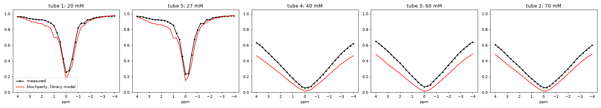
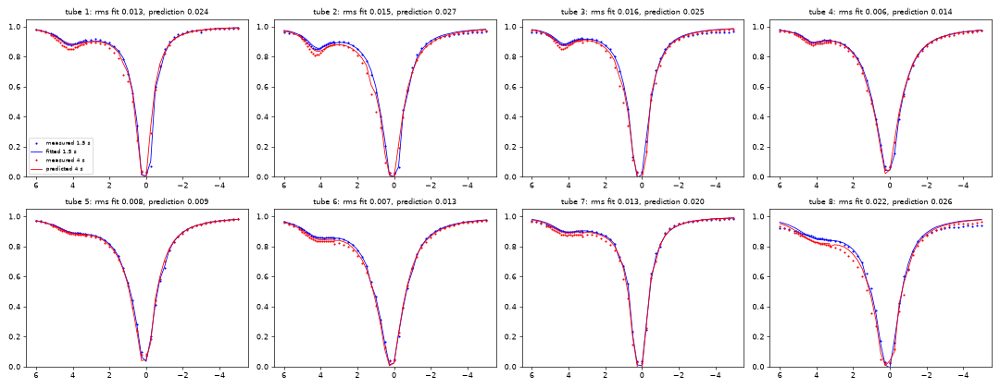
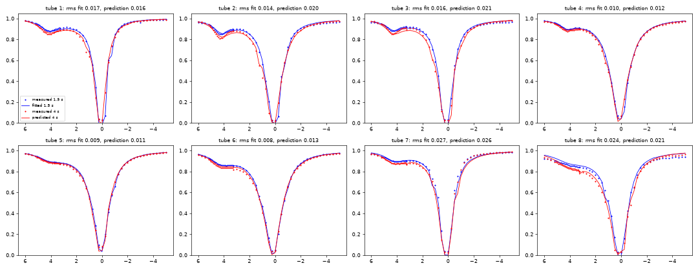

# Realism benchmark results

## Benchmark 1: NIST phantom T1 plane, 3 T IR spin echo (`nist_irse.py`)

The scanner's own 10 `.seq` files, simulated on a digital phantom whose T1/T2 come from
published references (**nothing fitted to this data**), against the scanner's raw data
(3 T Siemens Prisma Fit, 20 coils; Tong et al. 2022, CC BY 4.0). Metric: per-sphere
inversion-recovery curve shape error (one scale per sphere), see `README.md`.

Measured 2026-10-06, Apple M4, fused kernel, float32, 128 spin positions across ±1.5 slice
thicknesses × 2×2 per pixel (174 k spins), RF merged 4:1:

| model | spheres 1–10 | 1–14 | per sphere 1..14 [%] |
|---|---|---|---|
| analytic IR formula, T1 v1 | 27.30 % | 21.11 % | 31.8 37.5 35.3 33.2 30.0 30.0 25.2 21.5 17.6 10.9 10.8 7.2 3.2 1.4 |
| **Bloch on the scanner's .seq, T1 v1** | **2.76 %** | **2.39 %** | 4.2 7.2 5.2 2.8 1.3 1.5 1.4 0.3 1.7 1.9 2.8 2.2 0.6 0.3 |
| analytic IR formula, T1 v2 | 25.93 % | 19.88 % | 30.2 33.8 35.5 32.2 29.1 28.7 24.1 21.4 15.4 8.8 9.0 5.9 2.9 1.2 |
| **Bloch on the scanner's .seq, T1 v2** | **1.49 %** | **1.29 %** | 2.2 3.3 5.3 1.8 0.6 0.4 0.2 0.3 0.4 0.3 1.4 1.2 0.4 0.2 |

**Correction (2026-10-06):** the first version of this table (1.44 % / 2.67 %) used T2 values
that belong to the *MnCl2* (T2-plane) spheres. The NiCl2 spheres' T2 is now derived from their
T1 with the 3 T relaxivity ratio (`nist.py`); the change is small because T2 only scales each
curve at fixed TE.

The analytic formula is what the dataset's authors fitted, plus a free offset that absorbs
exactly the effects it lacks; without that offset it misses by ~26 %. Simulating the actual
sequence (sinc pulses and their slice profiles, the real timing, crushers and spoilers) gets
within ~1.5 % with no free parameter. Reference version 2 fits better than version 1
(consistent with, not proof of, a version-2 phantom; the serial isn't recorded).

### Convergence (T1 v2, RF merged 4:1)

| spins across slice × per pixel side | spins | time | spheres 1–10 | sphere 7 null (scanner 0.038) |
|---|---|---|---|---|
| 16 × 1 | 5.6 k | 20 s | 14.35 % | 0.280 |
| 32 × 1 | 10.9 k | 41 s | 13.63 % | 0.285 |
| 64 × 1 | 21.8 k | 89 s | 2.98 % | 0.054 |
| 32 × 2 | 43.8 k | 174 s | 7.52 % | 0.126 |
| 64 × 2 | 86.5 k | 318 s | 2.16 % | 0.038 |
| 128 × 2 | 174 k | 598 s | **1.44 %** | 0.037 |

Too few spins across the slice leave the crusher dephasing (~1.7 cycles per slice thickness)
unresolved: the magnitude of a few random phasors at a null isn't zero, so nulls stay shallow.
Exact RF (no merging) at 64 × 2: 2.03 % (v2) vs 2.16 % merged, so merging is not what limits.

### What's left (≈ 1–5 % on spheres 1–3, and 1–2 % on 11–12)

Not modelled yet, roughly in order of suspicion: phantom temperature (references are at
20 °C; long-T1 NiCl2 spheres are the most temperature-sensitive), the fill fluid around the
spheres (partial volume and ringing into the ROIs), coil sensitivities and B1⁺ variation
(constant per sphere for the shape metric, but not within a sphere's ROI), sphere wall
thickness. Each is a next step for the digital twin (`docs/REALISM.md`, R7).

## Benchmark 2: NIST phantom T2 plane, 3 T multi-echo spin echo (`nist_tse.py`)

The scanner's 23-echo CPMG `.seq` (echo spacing 7 ms, 180° windowed-sinc refocusing, slice and
readout crushers; two slices, the image is the second at x = −12 mm), simulated on a digital
T2 plane: T2 of the MnCl2 spheres from the phantom manual (spheres 1 and 5: Jiang et al. 2016),
T1 from the 3 T relaxivity ratio. Metric: per-sphere echo-train shape (one scale per sphere).

Measured 2026-10-06, Apple M4, fused kernel, float32, 64 spin positions across the slice × 4
per pixel along the readout (85 k spins), RF merged 4:1, 8 warm-up TRs before the imaged pass:

| model | spheres 1–10 | odd 1–9 | per sphere 1..14 [%] |
|---|---|---|---|
| mono-exponential, reference T2 | 10.47 % | 9.27 % | 4.2 4.9 5.8 7.3 5.7 9.5 11.2 15.1 19.6 21.5 32.3 41.2 42.0 53.1 |
| **Bloch on the scanner's .seq, nominal B1⁺** | **2.25 %** | **2.09 %** | 0.7 0.9 1.1 1.3 2.6 0.7 1.0 2.6 5.1 6.6 18.6 24.4 23.7 36.3 |
| Bloch + global B1⁺ 1.144 (fit on even spheres) | 1.90 % | 2.09 % | 0.8 0.7 0.6 0.5 4.0 1.6 2.3 0.8 2.7 5.0 16.5 22.9 21.4 34.6 |

- **The stimulated-echo signature comes out of the physics**: echo 1 below echo 2 (sphere 2:
  0.85 simulated vs 0.82 measured), and an apparent decay slower than T2 — both missed by the
  mono-exponential model that T2 fitting assumes (why the authors dropped echoes 1–3).
- **Convergence** (nominal B1⁺, spheres 1–10): 21 k spins 2.58 %, 85 k 2.25 %, 171 k 2.37 %,
  343 k 2.35 % (two different splits) — converged at ~2.3 %.
- **B1⁺ as a digital-twin parameter** (`nist_tse_b1.py`): echo shapes constrain |B1⁺ − 1| only,
  and the error is *highest* at nominal B1⁺. A global scale fitted on the even spheres (1.144,
  equivalently ~0.856) helps the fitted spheres but leaves the held-out odd spheres unchanged
  at converged density (2.09 %); smooth low-order maps overfit; a free B1⁺ per sphere (an upper
  bound, not a prediction) reaches 1.6 %. So B1⁺ is not the main remaining error.
- **What is**: (1) the **fill fluid** is not modelled. The deionised water around the spheres has
  T2 ≈ 2 s; at late echoes it blurs into the ROIs of short-T2 spheres (ROIs sit ~0.7 px inside
  the spheres), which is the flat tail on spheres 9–14 — not thermal noise, which is ~15–30× lower.
  (2) Reference-value uncertainty: the worst long-T2 sphere (5) is one whose T2 the manual
  withholds; MnCl2 T2 is temperature-sensitive and the scan temperature is unknown.

## Benchmark 3: NIST T2 plane, 3 T radial single-shot IR-bSSFP (`scholand_irbssfp.py`)

Scholand et al. 2023 (Zenodo 7654462; `scholand.py` has the protocol): 1000 radial spokes of
an IR-bSSFP (TR 4.88 ms, 45 deg, 1 ms sinc, hyperbolic-secant inversion, alpha/2 preparation) on a
Skyra, with a vendor B1 map and Cartesian IR-SE / SE gold standards of the same slice. No `.seq`
exists: the sequence is rebuilt from the paper, the authors' scripts and BART's simulator. The
transient is the measurement, so per-sphere curves come from a low-rank reconstruction
(`scholand_recon.py`). Its own accuracy was measured by pushing a digital copy of the phantom
(measured coil maps, trajectory, noise covariance) through it.

Measured 2026-10-07, Apple M4 GPU, 101 spins across the slice, rank-12 basis:

| sphere | 2 | 3 | 4 | 5 | 6 | 7 | 8 |
|---|---|---|---|---|---|---|---|
| gold T1 / T2 [ms] | 2271 / 386 | 1948 / 270 | 1591 / 182 | 1539 / 174 | 1053 / 95 | 842 / 70 | 633 / 49 |
| digital phantom: method bias T1 / T2 | +0 / −1 % | +2 / −7 % | +0 / +1 % | +0 / −1 % | −1 / +5 % | +3 / −7 % | −3 / +11 % |
| **measured, full model** | **−5 / −5 %** | **−7 / −1 %** | **+2 / −33 %** | **−4 / −14 %** | **−10 / −9 %** | −27 / +35 % | edge |
| measured, B1 = 1 | −4 / −14 % | −5 / −10 % | +3 / −40 % | −3 / −23 % | −9 / −19 % | −26 / +22 % | edge |
| measured, perfect inversion | −5 / −5 % | −7 / −3 % | +0 / −33 % | −4 / −14 % | −12 / −8 % | −29 / +41 % | edge |
| measured, no slice profile | −8 / +35 % | −9 / +43 % | −3 / +11 % | −8 / +35 % | −14 / +52 % | −30 / +111 % | edge |

- **The slice profile is the physics that matters**: without it T2 comes out 35–55 % high; with
  it −1 to −14 % (spheres 2, 3, 5, 6), as the authors found with their own Bloch model.
  The B1 map moves T2 by ~10 %. Hyperbolic-secant and perfect inversion differ by ≤ 2 %.
- **What is left is larger than the method's own error**: fit residuals 4–9 % against 1.4–2.3 %
  on the digital phantom, T1 4–10 % low, and sphere 4 (−33 % T2) disagreeing with its twin,
  sphere 5. The digital phantom uses the same coil maps and trajectory as the reconstruction and
  no off-resonance, so the candidates are exactly those (B0 is unmeasured; bSSFP is sensitive),
  plus the rebuilt sequence's unknowns (gradient waveforms, inversion-to-preparation gap).
- **Spheres 9–14 (T2 ≤ 33 ms) are beyond this pipeline**: the digital phantom does not recover
  them (−20 to +77 % T2, T1 on the grid edge), and the SE gold standard (first echo 15 ms)
  cannot measure them either (the authors' 735 ms for sphere 14 is the magnitude noise floor;
  the complex refit gives 25 ± 11 ms against NIST's 5.3 ms). **This dataset does not settle the
  short-T2 question of benchmark 2.**
- Sphere 1 (T2 1.4 s) is not determined by 5 s of bSSFP (digital: −41 % T2).
- Data facts found on the way: the vendor B1 map reads low in short-T1 spheres (0.87 against
  1.09 in sphere 14), so a smooth fit to the background water is used (spheres 1–5 agree with
  it to 0.02); the gradient delay is anisotropic, ~0.6–0.8 oversampled samples; the receiver
  phase follows the RF phase.

### Benchmark 3: tests of the remainder (2026-10-07)

All with the gold-standard T1/T2 fixed unless noted (residual over TRs 20–999, spheres 2–8):

- **Sphere 4 is B0**: −45 Hz brings it from 7.0 % to 4.0 % at the measured B1 (1.05); its
  −33 % T2 in the free fit was off-resonance absorbed into T2. Other spheres gain ≤ 0.5 pt.
- **Not one global sequence error**: an extra inversion-to-readout gap (0–200 ms), an
  inversion efficiency (0.7–1.0) or a spoke-to-TR shift (0–80 TRs) each help some spheres and
  hurt others (each sphere prefers a different value); per-sphere B0 + B1 drives B1 to the grid
  edge (0.70, measured 1.04) without fitting spheres 6–8.
- **Coil maps limit spheres 5–8**: changing only their smoothing (sigma 1.5 / 3 / 6 px) moves the
  curves by 1–4 % and the fitted T2 of spheres 5–8 by 10–30 points; spheres 2–3 stay at T1 −5 to
  −8 %, T2 within ±5 % in every variant. A digital twin generated with different coil maps from
  those of the reconstruction is still recovered (T1 ±5 %, T2 ±11 %), so the twin (discs, no
  insert, markers or real coil structure) is cleaner than the measurement: its floor is a lower
  bound, not the floor.
- Conclusion: spheres 2–3 (robust) show a real T1 underestimate of 5–8 %; 4 is B0; 5–8 are
  reconstruction-limited. A model-based reconstruction (fitting T1/T2/M0 maps to k-space, as the
  authors do) would remove the coil-map/subspace stage from the comparison.

## Benchmark 4: generalized Bloch on BSA / MnCl2 inversion recovery NMR (`asslaender_ir.py`)

Asslaender et al. 2022 (data at their cited commit): 1 T benchtop NMR, rectangular pi pulses of
22.8–912 us (1.8–70 T2 of the bound pool), 20 inversion times 3 ms–5 s, first FID point. Global
6-parameter fits as the authors' (m0, inversion efficiency, m0s, shared R1, T2s, Rex; free T2 =
T2* from the FID), compared with their published fits. Measured 2026-10-07, core, float64:

| 15 % BSA | m0s | R1 [/s] | T2s [us] | Rex [/s] | residual |
|---|---|---|---|---|---|
| authors (generalized Bloch, their solver) | 0.0855 ± 0.0010 | 1.1978 | 12.96 ± 0.61 | 71.3 ± 2.0 | 0.4136 % |
| exact-kernel reference (`simulate_pulse`, untapered) | 0.0851 ± 0.0011 | 1.1977 | 12.67 ± 0.66 | 71.6 ± 2.0 | 0.4127 % |
| **blochparty engine, memory 300 T2b (default)** | 0.0842 ± 0.0011 | 1.1977 | 12.64 ± 0.67 | 71.8 ± 2.0 | 0.4171 % |
| blochparty engine, memory 100 T2b (old default) | 0.0826 ± 0.0010 | 1.1976 | 12.58 ± 0.67 | 72.1 ± 2.0 | 0.4221 % |
| blochparty rate model | 0.0922 | 1.2093 | 1.90 | 229 | 1.307 % |
| authors, Graham's spectral model | 0.0699 | 1.1790 | 2.86 | 73.8 | 1.834 % |

- **The generalized Bloch engine fits real short-pulse MT data as well as its authors' model**
  (0.42 % vs 0.41 %), with the same parameters within ~1–3 σ; the rate model cannot (3x the
  residual, an unphysical T2s of 2 us), as the generalized Bloch paper says.
- **The Green's-function memory is visible in real data**: the engine reproduces its own tapered
  model exactly (post-pulse z within 4e-5 of the reference solver with the same taper), and the
  taper exp(-s / (100 T2b)) costs 4 % in chi^2 (194 dof) and biases m0s by −3 %. Memory 300 (still
  30 modes, fitted to 4e-5) halves both; the untapered kernel fits best. `BoundPool.memory`
  selects it; the default is 300 since 2026-10-07 (was 100).
- **MnCl2** (one pool) with the pulse in 50 segments: R1 1.478733 ± 0.002525 /s and residual
  0.6984 % — the authors' numbers to every printed digit. With the pulse as one segment, 0.839 %:
  the Strang split around a 180 deg rotation misses the T2* decay during the pulse.
  Hard pulses are now cut into <= 20 us segments by default (`sequence.MAX_RF_STEP`). The remaining misfit is in the shortest pulses (1.1 % at
  22.8 us vs 0.15–0.6 % for the rest), a pulse-length-dependent inversion efficiency of the
  hardware that a constant factor does not capture — the same in both samples.

## Benchmark 5: the scanner's own Pulseq spiral multi-echo TSE, T1MES phantom (`spiral_tse.py`)

Schuenke & Kolbitsch (Zenodo 18749100): the `.seq` played on a 3 T Siemens Cima.X (PTB, 16
channels) and its raw data: 10 echoes 16 ms apart, 160 spiral-out interleaves, TR 4 s. The
exact `.seq` is simulated (first three TRs, 1024 spins across 4 slice thicknesses, nominal
B1); measured curves from CG-SENSE (`spiral_tse_recon.py`). No independent 3 T T2 exists (the
T1MES values are from a 1.4 T relaxometer; agarose T2 is field- and echo-spacing-dependent, and
measures 35–50 % shorter here), so T2 is fitted per tube and the test is the echo-train shape.
Measured 2026-10-07, Apple M4 GPU:

| tube | 1 | 2 | 3 | 4 | 5 | 6 | 7 | 8 | 9 |
|---|---|---|---|---|---|---|---|---|---|
| fitted T2 [ms] (Bloch) | 28.7 | 34.1 | 180.9 | 31.9 | 29.5 | 30.2 | 111.5 | 119.1 | 117.7 |
| mono-exponential residual | 4.25 % | 3.93 % | 1.68 % | 3.91 % | 5.41 % | 4.77 % | 1.89 % | 1.95 % | 1.77 % |
| **Bloch, exact `.seq`, nominal B1** | **1.06 %** | **1.76 %** | **1.58 %** | **1.95 %** | **2.73 %** | **2.44 %** | **1.71 %** | **2.32 %** | **2.33 %** |
| method floor (digital twin, measured noise) | 0.40 % | 0.44 % | 0.16 % | 0.62 % | 0.44 % | 0.34 % | 0.18 % | 0.18 % | 0.21 % |

- **The stimulated-echo pattern comes out of the scanner's sequence**: 2–4x lower residuals
  than a mono-exponential for the short-T2 tubes; equal for the long-T2 ones, where the
  pattern is weak. The fitted global B1 is 1.00 (nominal is optimal), and a free B1 per tube
  changes nothing.
- **What is left** is < 1 % of echo 1 at every echo, 3–10x the method's floor: in the long-T2
  tubes the late even echoes sit low (a stronger odd/even modulation than predicted), in the
  short-T2 tubes the echo-1/echo-2 step. Not B0, B1, T1 or the refocusing scale (all tested).
  Candidates: the agarose's bound pool (saturated by the refocusing train), eddy-current phase
  errors (needs this scanner's GIRF), non-mono-exponential agarose T2.
- An earlier analysis reported a "tube 3 anomaly" (Bloch 3.8 % vs mono 1.2 %): an artefact of
  coil maps from a non-converging density compensation (`LESSONS.md`).

### Benchmark 5: tests of the remainder (2026-10-07)

Ruled out as the < 1 %-per-echo remainder (beyond B0 ±40 Hz, B1, T1 and the refocusing scale):

- **MT of the agarose** (Gaussian-lineshape literature values f = 0.0046, T2b 13 us, R 465 /s,
  bracketed with Lorentzian and super-Lorentzian, scaled by agarose content; also 4x f): residuals
  move by ≤ 0.1 pt.
- **Diffusion through the crushers** (D = 2.1e-9 m^2/s): the primary pathway's b-value grows
  linearly (0.92 s/mm^2 per echo), so its attenuation is exactly exponential and only shifts the
  fitted T2 (~2 %); stimulated pathways change by ~0.05 %. (Random-walk Monte Carlo is useless
  here: 32k walkers through strong crushers still differ by 2.7 % between seeds.)
- **A readout (gradient) delay**: the data consistency of the reconstruction is best at 0 us
  (scan −6 to +6 us).
- **The sequence's own balance**: in-plane moments between refocusing pulses ≤ 0.03 cycles/m; the
  z moments meet the CPMG condition exactly (4174.0016 = 2 x 2087.0008 cycles/m).

Left: hardware the data cannot show (eddy-current phase errors, RF amplitude/phase fidelity —
needs this scanner's GIRF or field-probe data) or non-mono-exponential T2 of the gel.

## Benchmark 6: gradient timing of a Pulseq radial scan, Siemens Cima.X (`radial.py`)

Data: [Zenodo 14228459](https://zenodo.org/records/14228459) (PTB, MAGNETOM Cima.X, 2.89 T,
8-channel head/neck coil): golden-angle radial GRE, 5 slices of 8 mm (z = -16 .. 16 mm), 402
spokes each, 256 samples at 10 us with no oversampling, FOV 256 mm, TR 5.64 ms; the `.seq` and the
acquired ISMRMRD file with the nominal trajectory. The phantom is a round object ~19 cm across,
centred within 3 / 5 mm (projection centroids).

**Trajectory.** k at every ADC sample of blochparty's import of the `.seq` (sample i at
(i + 1/2) dwell) equals the file's trajectory to 7.3e-4 / FOV (float32 storage), axes unchanged.

**Measured delays.** Echo shift of each spoke against its antiparallel partner (within 0.3 deg:
250 pairs), fitted by d(theta) = dx cos^2 + dy sin^2 + 2 dxy sin cos: **dx +0.20, dy +0.65,
dxy +0.05 us** (effective gradient-to-ADC delays), scatter 0.05 us. Fitted on slices 0/2/4 it
predicts slices 1/3 to 0.040-0.048 us rms (0.43-0.45 us without delays); fitted on 1/3, slices
0/2/4 to 0.042-0.071 us. The vendor's delay compensation leaves well under a microsecond
(0.065 samples): blochparty's default (ideal timing) is within that of this scanner.

**Engine and estimator** (the same estimator on blochparty simulations of the `.seq` with
`GIRF.identity` delays; 3.45 M segments, 20-60 s each on the M4 GPU):

| Object | Coils | Imposed (dx, dy) us | Estimated (dx, dy), dxy us |
|---|---|---|---|
| off-centre ellipse | 1 | (0, 0) | (+0.001, -0.001), -0.002 |
| off-centre ellipse | 1 | (3, 3) | (+3.002, +2.999), -0.002 |
| off-centre ellipse | 1 | (3, -2) | (+3.375, -1.533), +0.115 |
| off-centre ellipse | 1 | (0.2, 0.65) | (+0.167, +0.607), -0.013 |
| 19 cm disc, (-3, +5) mm | 8 loops | (0.2, 0.65) | (+0.203, +0.649), -0.004 |
| 19 cm disc, (-3, +5) mm | 8 loops | (3, -2) | (+3.012, -1.994), -0.007 |

The engine turns delays into the echo shifts they should give (exact for equal delays, where
the estimator is unbiased). With unequal delays the partners are also shifted sideways, in
opposite directions, so they sample two lines and an off-centre object tilts their cross-phase:
the estimator is biased by up to 0.4 us for the asymmetric ellipse at |dx - dy| = 5 us, but by
<= 0.005 us for an object like the measured one. The measured delays stand.

Not tested here: GIRF shape (eddy currents beyond a delay) and B0 terms. This scanner has no
published GIRF; the GIRF dataset (Zenodo 6376737) comes from a different site.

## Benchmark 7: a measured GIRF through `apply_girf`, Siemens Prisma (`girf.py`)

Data: Wu et al., ISMRM 2022 #641, [Zenodo 6376737](https://zenodo.org/records/6376737) (3 T
Prisma, Toronto; processing code github.com/BRAIN-TO/girfISMRM2022 at 92bc337). Thin-slice method:
1 mm slices at +-17 mm per axis, 18 triangle blips (180 T/m/s, 9-39.6 mT/m) 2 ms into a 50 ms ADC
(5 us), 50 repetitions; Meas1 positive blips, Meas2 eight months later both polarities. The
released raw signals are coil-averaged.

**Port.** Output gradients from the slice-pair phase derivatives (Python port of the authors'
code). Our GIRF from Meas1 (H = sum O conj(I) / sum |I|^2, raised-cosine band limit 24-30 kHz):
DC gain 1.0015 / 1.0002 / 1.0000 (x / y / z); it equals the authors' precomputed Meas1 GIRF (coils
processed separately) to <= 0.054 below 10 kHz once their input frame (point samples) is moved
half a dwell onto ours (cell averages); our delays 1.58 / 1.62 / 4.41 us are theirs (4.03 / 4.13 /
6.90 us) minus that 2.5 us.

**Held-out prediction.** Meas2's measured outputs predicted from Meas1 through blochparty
(`GIRF` taps from the transfer function, a -0.5 .. +3.5 ms window keeping the DC gain to 7e-4,
`apply_girf` on 5 us segments; agrees with a direct FFT convolution to 0.026 mT/m): rms error over
1.9-3.5 ms relative to the blip peak, median over the 18 blips (max):

| Axis | Polarity | Ideal | Pure delay (Meas1) | GIRF (Meas1) |
|---|---|---|---|---|
| x | + | 0.67 (1.71) % | 0.38 (1.29) % | **0.14 (0.53) %** |
| x | - | 0.69 (1.92) % | 0.43 (1.55) % | **0.16 (0.55) %** |
| y | + | 0.99 (2.26) % | 0.57 (1.65) % | **0.37 (0.73) %** |
| y | - | 1.00 (2.26) % | 0.58 (1.64) % | **0.38 (0.70) %** |
| z | + | 1.59 (3.58) % | 0.63 (1.64) % | **0.12 (0.34) %** |
| z | - | 1.61 (3.63) % | 0.63 (1.68) % | **0.13 (0.42) %** |

The GIRF from positive blips predicts the negative ones as well (linearity), eight months later.
y keeps the largest residual: its delay itself moved by ~1 us between the measurements (authors'
values 4.13 -> 5.18 us). Moment errors at the end of the window are <= 0.05 % for all models (DC
gain ~1: the GIRF matters for the waveform shape, i.e. for k-space timing during the gradient, not
for the area).

**B0 term (not validated).** The common-mode phase of the slice pair accumulates <= 0.022 rad over
10 ms in the part that flips with blip polarity (what a GIRF B0 row predicts; predicted <= 0.029,
rms difference 0.011-0.029 rad), while the polarity-independent part reaches 0.6 rad (drift left
after the reference correction, ~10 Hz). The B0 eddy term of this scanner is below what the
released coil-averaged data resolve. Its DC part (-8 to -14 Hz per mT/m) is what a 0.2-0.3 mm
asymmetry of the slice pair gives: geometry, not eddy currents.

**Slice profile (finding, not modelled).** |S / ref| after the largest blip (8.7 mT/m ms, k = 371
/m) is 0.53, after the middle one (3.0 mT/m ms) 0.906; a 1 mm rectangular profile would give 0.79
and 0.973. The excited profile is wider than nominal (1.7 mm as a rectangle, 1.14 mm FWHM as a
Gaussian; neither fits both), consistent with a sinc pulse's tails. The pulse is not published.

## Benchmark 8 (consistency): Pulseq-CEST APTw Z-spectra of an L-arginine phantom (`magma.py`)

Data: Pulseq-CEST Library MAGMA 2025 phantom ([Zenodo 15053086](https://zenodo.org/records/15053086);
3 T Prisma fit, 123.2 MHz), magnitude DICOMs after the library's `APTw_3T_001` preparation (36
sinc-Gauss pulses of 50 ms, B1rms 2 uT, 33 offsets +-4 ppm) and its WASABI. Five tubes (Schuenke
et al., MAGMA 2025, Table 1): 1 mM Gadovist, L-arginine 20 / 27 mM without and 40 / 60 / 70 mM with
2 % agarose, pH ~4. Tubes found by matching the wall annulus (slice 5); tube 1 contains the
authors' ROI (their V[row, col, slice, offset]); plain vs agarose from the direct-saturation width;
40 / 60 / 70 mM assigned by the measured MTRasym ranking (assumption).

**Engine.** blochparty on the APTw `.seq` equals BMCTool 1.0.3 on the same file and models to
<= 8e-4 in Z (20 and 70 mM models). Each offset is simulated in the frame of its RF (exact change
of frame; the .seq's pulses then step at 100 us): equal to the scanner frame at 10 us within 2e-5
at 0.5 / 1.5 / 3 ppm, 7-8x faster.

**Fields.** WASABI (analytic model, fit per voxel): rB1 1.00-1.03, dB0 -8 to -10 Hz per tube.

**Models vs measurement** (the library's tube YAMLs, unchanged; voxel fields as a 3 x 3 quantile
grid; |Z| since the images are magnitudes):

| Tube | rms over 33 offsets | max abs dZ | MTRasym(3 ppm) measured / simulated |
|---|---|---|---|
| 20 mM | 0.053 | 0.15 at +1 ppm | +0.025 / +0.057 |
| 27 mM | 0.058 | 0.17 at +1 ppm | +0.030 / +0.074 |
| 40 mM (agarose) | 0.109 | 0.16 at +4 ppm | +0.015 / +0.021 |
| 60 mM (agarose) | 0.124 | 0.17 at +3.5 ppm | +0.016 / +0.034 |
| 70 mM (agarose) | 0.085 | 0.12 at +4 ppm | +0.020 / +0.039 |

**On the Apple GPU** (`BLOCHPARTY_BACKEND=metal`, 2026-10-08): the table above reproduced digit for
digit; Z within 8.3e-6 of the core over all tubes, voxels and offsets.

The library's models do not reproduce these measurements: the agarose tubes are over-saturated
(Z 0.47 vs 0.62 at +-4 ppm: MT pool or water T2 = 50 ms off) and the CEST asymmetry is 1.4-2.5x
too large; playing the 3.5 s recovery from a saturated readout instead of the library's reset
changes the rms by <= 0.005. As the engine matches BMCTool on the same .seq, this is a statement
about the models (described in their files as simplified, partly tuned), not the simulator. A
predictive CEST test needs held-out conditions: benchmark 9.

## Benchmark 9: CEST saturation-time prediction, iohexol phantom, Siemens Vida (`iohexol.py`)

Data: Huemer et al., MRM 2025 ([Zenodo 17244380](https://zenodo.org/records/17244380), members
range-read by `fetch_iohexol.py`): two conventional CEST reference scans of one phantom (Falcon
tubes of iohexol with Gadovist; concentrations not published) at 123.26 MHz, 28 min apart, 3D
Cartesian GRE (128 x 128 x 3, 4 deg, TR 5.2 ms, centric: the k-space centre is the first of 384
lines), Trec 3.5 s, M0 at -1500 ppm after 10 s, 57 offsets -5..6 ppm; saturation by 15 (1.514 s)
and 40 (4.04 s) optimal-control pulses of 100 ms with 1 ms gaps. The 40-pulse .seq is not in the
archive (the raw header names it) and is rebuilt from the 15-pulse one.

**Reconstruction.** Raw data with our own twix reader (`twix.py`): 22272 ADCs x 16 coils x 128,
k-space positions from pypulseq's trajectory of the .seq, 3D FFT, coil combination with M0
sensitivities; central partition. (The archive's prepared `.mat` spectra were not used: 57 columns
for 58 offsets, a zero normalisation column and a water minimum at different columns in the two
files.) Eight tube ROIs from the +1 ppm image (hydroxyl exchange: every tube, not the bath). The
authors' WASABI B0 / B1 maps are transposed relative to our images (edge registration: 0.74 vs
<= 0.67 for the other orientations). Field drift since WASABI from the bath's water dip: +13.0 Hz
(1.5 s scan) and +18.3 Hz (4 s scan).

**Simulation.** Per offset: Trec, the saturation train in its RF frame, ideal spoiling, then the
readout as 384 spoiled 4 deg hard pulses (centric: Z = Mz before the first line over the M0
scan's), offsets coupled through readout and recovery (iterated). All 58 offsets x tubes x
parameter sets are spins of one simulation: each offset's per-pulse RF phase step moved into the
gaps as a rotation (a gap gradient, spins at x = dpsi / (2 pi G t_gap)); equal to explicit
per-offset simulation to 3e-5. Water + amide pool (4.3 ppm, T2 10 ms) + hydroxyl pool (free shift).

**Calibration at 1.5 s** (Levenberg-Marquardt, Jacobian by batched finite differences, 200 us RF
steps, 10 iterations): rms 0.006-0.022 per tube (median 0.013); T1 0.39-0.90 s, T2 0.09-0.23 s,
amide f 1.5-2.8e-3, k 210-880 Hz; the hydroxyl pool is poorly determined (bounds in 5 tubes).

**Prediction at 4 s** (nothing refitted; the 4 s scan's own drift; 100 us steps):

| Tube | rms fit 1.5 s | rms predicted 4 s | rms "no change" | change at 4.3 ppm measured / predicted |
|---|---|---|---|---|
| 1 | 0.013 | 0.024 | 0.042 | -0.031 / -0.005 |
| 2 | 0.015 | 0.027 | 0.043 | -0.042 / -0.023 |
| 3 | 0.016 | 0.025 | 0.035 | -0.030 / -0.013 |
| 4 | 0.006 | 0.014 | 0.020 | -0.014 / -0.003 |
| 5 | 0.008 | 0.009 | 0.015 | -0.008 / -0.004 |
| 6 | 0.008 | 0.013 | 0.024 | -0.023 / -0.012 |
| 7 | 0.013 | 0.020 | 0.029 | -0.023 / -0.006 |
| 8 | 0.022 | 0.026 | 0.048 | -0.028 / -0.022 |

**On the Apple GPU** (`BLOCHPARTY_BACKEND=metal uv run python validation/real/iohexol.py predict`,
2026-10-08): the table above reproduced digit for digit (median prediction rms 0.022, correlation
0.75), the whole `predict` run in 27 s. One pass of the simulation, core vs Metal (Z within
3.5e-7 of the core):

| spectra call | core | Metal | |
|---|---|---|---|
| 8 tubes, 15 pulses, 100 us RF steps (prediction) | 37.6 s | 5.5 s | 7x |
| 8 tubes x 8 parameter sets, 15 pulses, 200 us (one fit iteration) | 141 s | 5.7 s | 25x |
| 8 tubes, 40 pulses, 100 us (prediction) | 114 s | 8.6 s | 13x |

The GPU time is mostly two kinds of slow spins: the M0 offset at -1500 ppm (~80 Taylor sub-steps
per 100 us RF sample, the other offsets ~2; it bounds a call at ~1.5 s however few spins) and
tube 8's hydroxyl exchange at its 40 kHz bound (~280 sub-steps per 5.2 ms readout TR). Free segments
could be made exact and cached (ROADMAP M1a, "Left").

The prediction beats "no change" in every tube (median 0.022 vs 0.032) and the predicted change
correlates 0.75 with the measured one over all tubes and offsets, but the CEST build-up from 1.5 to
4 s is under-predicted 1.3-6x at 4.3 ppm. From one saturation time, T1 trades against the pool
sizes; a T1 that is too short reaches the steady state too early, which is this pattern.

**Independent T1 (`iohexol_t1.py`).** IR Look-Locker of the same phantom (3D stack-of-stars, 798 x 6
deg every 5.01 ms after one inversion; subspace NUFFT reconstruction with a K = 6 Look-Locker basis,
central slice: the edge slices see less than the nominal flip and gave T1* above the bound that 6
deg every 5 ms sets). Per-tube fit A - B exp(-t R1*) for t >= 0.15 s (an early transient), fit
residuals 0.4-1.4 % of the amplitude (K = 4: 4-13 %, T1 shifting with the start time), T1 within
6 % for a start at 0.15 or 0.3 s. T1 = 1 / (R1* + ln cos(6 deg B1) / TR):

| Tube | 1 | 2 | 3 | 4 | 5 | 6 | 7 | 8 |
|---|---|---|---|---|---|---|---|---|
| T1 IR-LL [s] | 0.875 | 1.228 | 1.420 | 0.595 | 0.482 | 0.676 | 0.982 | 1.461 |
| T1 fitted from the 1.5 s CEST data [s] | 0.468 | 0.904 | 0.727 | 0.388 | 0.420 | 0.673 | 0.539 | 0.882 |

The single-Tsat calibration underestimated T1 in six of eight tubes (by up to 2x) and agreed in two
(5, 6).

**Prediction with T1 fixed to the IR-LL values** (`iohexol.py fit_t1`, `predict_t1`; the other six
parameters recalibrated at 1.5 s, rms 0.008-0.027):

| Tube | rms fit 1.5 s | rms predicted 4 s | rms "no change" | change at 4.3 ppm measured / predicted |
|---|---|---|---|---|
| 1 | 0.017 | 0.016 | 0.042 | -0.031 / -0.019 |
| 2 | 0.015 | 0.020 | 0.043 | -0.042 / -0.034 |
| 3 | 0.016 | 0.021 | 0.035 | -0.030 / -0.032 |
| 4 | 0.010 | 0.012 | 0.020 | -0.014 / -0.008 |
| 5 | 0.009 | 0.011 | 0.015 | -0.008 / -0.005 |
| 6 | 0.008 | 0.013 | 0.024 | -0.023 / -0.013 |
| 7 | 0.027 | 0.026 | 0.029 | -0.023 / -0.021 |
| 8 | 0.024 | 0.021 | 0.048 | -0.028 / -0.033 |

Median prediction rms 0.018 (T1 fitted: 0.022; no change: 0.032); the predicted 1.5 -> 4 s change
correlates 0.81 with the measured one (0.75); at 4.3 ppm the predicted build-up is 0.5-1.2x the
measured (0.16-0.79x before), within 0.8-1.2x in tubes 2, 3, 7, 8. Remaining: tubes 1, 4, 5, 6
still about half; candidates are the single hydroxyl pool (at bounds in 5 tubes), the amide pool's
T2 (fixed 10 ms) and the Look-Locker T1's flip-angle dependence (Deichmann's estimate is 30-50 %
longer).

## Monte Carlo estimation (`nist.py`: `*_qmc`, `mc_magnitude`, `jackknife`)

Spins are a Monte Carlo sample of the continuous object. Magnitude images turn the complex
image's (zero-mean) MC noise into an upward bias E|s + n| ≈ |s| + σ²/2|s|, largest where the
signal is small. The tools: scrambled-Sobol spin placement (Cranley–Patterson shift per pixel),
importance sampling for the water fill, K independent seeds averaged in the complex domain, the
bias σ² removed using the seed spread, and jackknife error bars over seeds.

**Validation** on a uniform water patch through the real TSE sequence (8 seeds each, Apple GPU):

| spins / pixel | stratified: per-pixel MC error of one run | Sobol | bias-corrected level, echo 1 / 15 |
|---|---|---|---|
| 64 | 0.40 | 0.17–0.22 | 0.595–0.600 / 0.659–0.668 |
| 256 | 0.23 | 0.07–0.09 | 0.593–0.594 / 0.661–0.662 |
| 1024 | 0.12 | 0.03–0.04 | 0.594–0.595 / 0.663 |

Stratified falls as N^-1/2, Sobol ≈ N^-0.75 (≈ 12× fewer spins than stratified at 1024 for the
same error); the bias-corrected level agrees to ~1 % at every density.

**Benchmark 2 with Monte Carlo estimation and the water fill** (Sobol 256 spins/pixel, water within
8 px of a wall, full density within 3 px and ¼ beyond, 1 mm walls, water T1/T2 3.0/2.0 s; 4 seeds,
± jackknife SE; Apple GPU, ~18 min):

| model | spheres 1–10 | per sphere 1..14 [%] |
|---|---|---|
| mono-exponential, reference T2 | 10.47 % | 4.2 4.9 5.8 7.3 5.7 9.5 11.2 15.1 19.6 21.5 32.3 41.2 42.0 53.1 |
| Bloch MC, spheres only | 2.38 ± 0.06 % | 0.6 0.8 1.2 1.4 2.5 1.0 1.3 2.6 5.7 6.6 19.4 28.8 27.2 39.1 |
| **Bloch MC + water fill** | **2.20 ± 0.04 %** | 0.7 0.8 1.2 1.5 2.9 1.1 1.3 2.8 3.6 6.1 **7.8 13.4 15.2 22.1** |

The spheres-only MC result reproduces the converged brute-force runs (2.25–2.37 %). The water
fill, which looked harmful when undersampled (5.75 % with 64 stratified spins/pixel: MC bias),
roughly halves the error of the short-T2 spheres 9 and 11–14 once estimated properly, as the
original hypothesis predicted; long-T2 spheres are unchanged within error.

**Wall-thickness sensitivity** (the sphere walls are not in the real-data images; 1 mm was a
guess). Same settings, 3 seeds for 0.5 / 1.5 mm:

| wall | spheres 1–10 | 9 | 10 | 11 | 12 | 13 | 14 |
|---|---|---|---|---|---|---|---|
| 0.5 mm | 2.93 ± 0.16 % | 6.0 | 11.4 | 9.9 | 10.8 | 15.8 | 23.3 |
| 1.0 mm | 2.20 ± 0.04 % | 3.6 | 6.1 | 7.8 | 13.4 | 15.2 | 22.1 |
| 1.5 mm | 2.10 ± 0.11 % | 3.6 | 5.0 | 7.5 | 12.7 | 16.1 | 27.6 |

The wall matters for spheres 9–10: a thin wall lets too much water blur in. Between 1 and 1.5 mm
the difference is within ~1 SE. The shortest-T2 spheres 13–14 hardly respond to the wall, so
something other than the wall limits them.

**What limits the short-T2 spheres.** In the measured curves, spheres 11–14 level off at 8–12 %
of echo 1, 7–12σ above the noise floor (σ measured in the air, Rayleigh-consistent). That is
water blurring in, not noise. Two tests, each varying one thing:

1. *Simulated vs measured curves* (water fill, 2 seeds): the simulated tail level is wrong in
   both directions, too high on spheres 10, 11, 13 and 14 (sphere 14: 17 % vs 12 %) and too
   low on 12. This level depends on where the spheres sit relative to the slice and the ROIs,
   which we only know approximately. The echo 2 / echo 1 ratio is also too low, more so the
   shorter T2 is (sphere 12: 0.76 sim vs 0.91 measured; 13: 0.66 vs 0.80; 14: 0.51 vs 0.72).
2. *Spheres only with T2 scaled, fitted as a·sim + b·e^(−TE/2 s)* (tail amplitude b free, so
   the water geometry drops out; relative RMS residual, %):

| sphere | 1 | 2 | 3 | 4 | 5 | 6 | 7 | 8 | 9 | 10 | 11 | 12 | 13 | 14 |
|---|---|---|---|---|---|---|---|---|---|---|---|---|---|---|
| T2 × 1.0 | 0.7 | 0.9 | 1.0 | 1.2 | 2.6 | 0.9 | 1.3 | 1.7 | 2.3 | 2.3 | 6.5 | 8.0 | 7.6 | 8.7 |
| T2 × 1.25 | 1.5 | 1.8 | 2.6 | 3.5 | 7.6 | 7.1 | 8.8 | 7.7 | 5.9 | 8.1 | 9.7 | 11.8 | 8.6 | 6.9 |
| T2 × 1.5 | 2.3 | 3.1 | 4.5 | 6.3 | 11.0 | 12.2 | 15.1 | 15.2 | 13.8 | 15.3 | 15.0 | 17.0 | 13.5 | 9.7 |

The reference T2 values are right: longer T2 is worse for spheres 1–13; only sphere 14 (5.3 ms)
prefers a slightly longer value. With the tail level free, spheres 9–10 drop to 2.3 %, so their
error was the water geometry. Spheres 11–14 stay at 6.5–8.7 %. Their residual misfit is in the
first echoes, where T2 is comparable to the 7 ms echo spacing and the odd/even stimulated-echo
balance depends on refocusing details (B1⁺ and the refocusing pulse at the sphere positions).
That is the open question, not the reference values.

**Benchmark 1 with Monte Carlo estimation** (T1 v2; Sobol 256 spins/pixel; 4 seeds, ± jackknife SE;
Apple GPU: 3 min spheres only, 20 min with water):

| model | spheres 1–10 | per sphere 1..14 [%] |
|---|---|---|
| analytic IR formula | 25.93 % | 30.2 33.8 35.5 32.2 29.1 28.7 24.1 21.4 15.4 8.8 9.0 5.9 2.9 1.2 |
| Bloch MC, spheres only | 1.77 ± 0.19 % | 1.7 4.9 4.6 1.0 0.8 0.9 0.8 1.1 1.2 0.6 1.2 1.3 0.4 0.2 |
| Bloch MC + water fill | 1.88 ± 0.20 % | 1.9 4.7 4.6 1.3 1.8 1.1 0.8 0.8 1.0 0.8 1.0 1.6 0.4 0.5 |

Consistent with the brute-force 1.49 % within ~1.5 SE; the water fill makes no significant
difference on this plane (long-T2 NiCl2 spheres next to long-T2 water). The error bars are
dominated by spheres 2–3 (±1.3 / ±0.3 %), whose curves pass near the null at TI 1000 ms where
the bias correction is least certain.

At **1024 Sobol spins/pixel** (spheres only, 4 seeds, 22 min on the Apple GPU):

| model | spheres 1–10 | per sphere 1..14 [%] |
|---|---|---|
| Bloch MC, T1 v2, 1024 spins/pixel | **1.51 ± 0.05 %** | 2.4 4.0 5.2 1.5 0.4 0.5 0.3 0.2 0.3 0.3 1.2 1.2 0.4 0.2 |

The error bar shrinks 4× for 4× the spins, faster than the N^-0.75 Sobol rate predicts (2.8×),
because at 256 spins it was dominated by the near-null bias of spheres 2–3. The result matches
the brute-force 1.49 %. What remains is a model misfit on spheres 1–3 (the longest T1),
not sampling noise.

**Recheck of the error bars (2026-10-08).** The ± above combine the per-sphere SEs as if the
spheres were independent, sqrt(Σ se²)/10. The scripts now jackknife the spheres-1–10 mean
itself (`nist.mc_errors`), which keeps the covariance between spheres. The same 256-spin run
was repeated with 8 seeds (T1 v2, spheres only, Apple GPU, 57 s per seed). Seeds 0–3
reproduce the 4-seed row above exactly.

| seeds | spheres 1–10 | old ± (independent) | jackknife of the mean | jackknife bias-corrected |
|---|---|---|---|---|
| 0–3 (the row above) | 1.77 % | 0.19 | **0.31** | 1.71 % |
| 4–7 | 1.84 % | 0.28 | 0.19 | |
| 0–7 | 1.73 % | 0.17 | 0.22 | 1.66 % |

- The independence formula underestimated the historical bar by 1.65×. With 4 seeds the bar
  itself is unreliable (0.31 vs 0.19 for two disjoint sets of 4 seeds), so the "4× smaller at
  1024 spins" above compares two noisy numbers (the 1024-spin images were not kept, so its
  bar cannot be recomputed).
- Clipping of the debiased power is rare: ≤ 3 % of ROI pixels per sphere, at TI indices 6, 8
  and 9 for spheres 1–2. It does not explain the 256 → 1024 shift. With 8 seeds, spheres 2–3
  at 256 spins match 1024 spins (4.1 / 5.4 vs 4.0 / 5.2 %).
- The shift is mostly a different bias: residual MC noise in the curves adds to an RMS shape
  error. The spheres-1–10 mean falls with the number of seeds averaged (2, 4, 8 seeds:
  1.90, 1.80, 1.73 %), and the jackknife bias correction (now printed) moves it to 1.66 %.
  The remaining gap to 1.51 % is in spheres 5–10 (8 seeds: 0.4–0.9 vs 0.2–0.5 % at 1024
  spins), whose small errors are the most noise-inflated.
