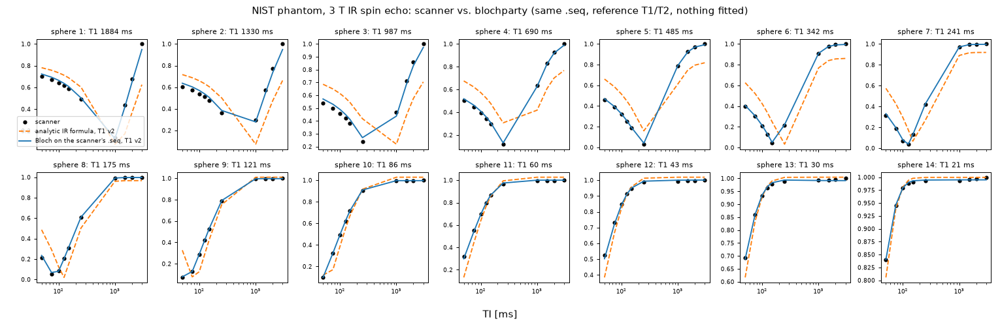
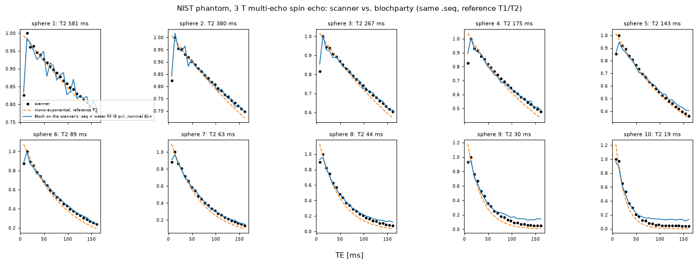

# Realism benchmark results

## Benchmark 1: NIST phantom T1 plane, 3 T IR spin echo (`nist_irse.py`)

The scanner's own 10 `.seq` files, simulated on a digital phantom whose T1/T2 come from
published references (**nothing fitted to this data**), against the scanner's raw data
(3 T Siemens Prisma Fit, 20 coils; Tong et al. 2022, CC BY 4.0). Metric: per-sphere
inversion-recovery curve shape error (one scale per sphere), see `README.md`.

Measured 2026-10-06, Apple M4, fused kernel, float32, 128 spin positions across ±1.5 slice
thicknesses × 2×2 per pixel (174 k spins), RF merged 4:1:

| model | spheres 1–10 | 1–14 | per sphere 1..14 [%] |
|---|---|---|---|
| analytic IR formula, T1 v1 | 27.30 % | 21.11 % | 31.8 37.5 35.3 33.2 30.0 30.0 25.2 21.5 17.6 10.9 10.8 7.2 3.2 1.4 |
| **Bloch on the scanner's .seq, T1 v1** | **2.76 %** | **2.39 %** | 4.2 7.2 5.2 2.8 1.3 1.5 1.4 0.3 1.7 1.9 2.8 2.2 0.6 0.3 |
| analytic IR formula, T1 v2 | 25.93 % | 19.88 % | 30.2 33.8 35.5 32.2 29.1 28.7 24.1 21.4 15.4 8.8 9.0 5.9 2.9 1.2 |
| **Bloch on the scanner's .seq, T1 v2** | **1.49 %** | **1.29 %** | 2.2 3.3 5.3 1.8 0.6 0.4 0.2 0.3 0.4 0.3 1.4 1.2 0.4 0.2 |

**Correction (2026-10-06):** the first version of this table (1.44 % / 2.67 %) used T2 values
that belong to the *MnCl2* (T2-plane) spheres. The NiCl2 spheres' T2 is now derived from their
T1 with the 3 T relaxivity ratio (`nist.py`); the change is small because T2 only scales each
curve at fixed TE.

The analytic formula is what the dataset's authors fitted, plus a free offset that absorbs
exactly the effects it lacks; without that offset it misses by ~26 %. Simulating the actual
sequence (sinc pulses and their slice profiles, the real timing, crushers and spoilers) gets
within ~1.5 % with no free parameter. Reference version 2 fits better than version 1
(consistent with, not proof of, a version-2 phantom; the serial isn't recorded).

### Convergence (T1 v2, RF merged 4:1)

| spins across slice × per pixel side | spins | time | spheres 1–10 | sphere 7 null (scanner 0.038) |
|---|---|---|---|---|
| 16 × 1 | 5.6 k | 20 s | 14.35 % | 0.280 |
| 32 × 1 | 10.9 k | 41 s | 13.63 % | 0.285 |
| 64 × 1 | 21.8 k | 89 s | 2.98 % | 0.054 |
| 32 × 2 | 43.8 k | 174 s | 7.52 % | 0.126 |
| 64 × 2 | 86.5 k | 318 s | 2.16 % | 0.038 |
| 128 × 2 | 174 k | 598 s | **1.44 %** | 0.037 |

Too few spins across the slice leave the crusher dephasing (~1.7 cycles per slice thickness)
unresolved: the magnitude of a few random phasors at a null isn't zero, so nulls stay shallow.
Exact RF (no merging) at 64 × 2: 2.03 % (v2) vs 2.16 % merged, so merging is not what limits.

### What's left (≈ 1–5 % on spheres 1–3, and 1–2 % on 11–12)

Not modelled yet, roughly in order of suspicion: phantom temperature (references are at
20 °C; long-T1 NiCl2 spheres are the most temperature-sensitive), the fill fluid around the
spheres (partial volume and ringing into the ROIs), coil sensitivities and B1⁺ variation
(constant per sphere for the shape metric, but not within a sphere's ROI), sphere wall
thickness. Each is a next step for the digital twin (`docs/REALISM.md`, R7).

## Benchmark 2: NIST phantom T2 plane, 3 T multi-echo spin echo (`nist_tse.py`)

The scanner's 23-echo CPMG `.seq` (echo spacing 7 ms, 180° windowed-sinc refocusing, slice and
readout crushers; two slices, the image is the second at x = −12 mm), simulated on a digital
T2 plane: T2 of the MnCl2 spheres from the phantom manual (spheres 1 and 5: Jiang et al. 2016),
T1 from the 3 T relaxivity ratio. Metric: per-sphere echo-train shape (one scale per sphere).

Measured 2026-10-06, Apple M4, fused kernel, float32, 64 spin positions across the slice × 4
per pixel along the readout (85 k spins), RF merged 4:1, 8 warm-up TRs before the imaged pass:

| model | spheres 1–10 | odd 1–9 | per sphere 1..14 [%] |
|---|---|---|---|
| mono-exponential, reference T2 | 10.47 % | 9.27 % | 4.2 4.9 5.8 7.3 5.7 9.5 11.2 15.1 19.6 21.5 32.3 41.2 42.0 53.1 |
| **Bloch on the scanner's .seq, nominal B1⁺** | **2.25 %** | **2.09 %** | 0.7 0.9 1.1 1.3 2.6 0.7 1.0 2.6 5.1 6.6 18.6 24.4 23.7 36.3 |
| Bloch + global B1⁺ 1.144 (fit on even spheres) | 1.90 % | 2.09 % | 0.8 0.7 0.6 0.5 4.0 1.6 2.3 0.8 2.7 5.0 16.5 22.9 21.4 34.6 |

- **The stimulated-echo signature comes out of the physics**: echo 1 below echo 2 (sphere 2:
  0.85 simulated vs 0.82 measured), and an apparent decay slower than T2 — both missed by the
  mono-exponential model that T2 fitting assumes (why the authors dropped echoes 1–3).
- **Convergence** (nominal B1⁺, spheres 1–10): 21 k spins 2.58 %, 85 k 2.25 %, 171 k 2.37 %,
  343 k 2.35 % (two different splits) — converged at ~2.3 %.
- **B1⁺ as a digital-twin parameter** (`nist_tse_b1.py`): echo shapes constrain |B1⁺ − 1| only,
  and the error is *highest* at nominal B1⁺. A global scale fitted on the even spheres (1.144,
  equivalently ~0.856) helps the fitted spheres but leaves the held-out odd spheres unchanged
  at converged density (2.09 %); smooth low-order maps overfit; a free B1⁺ per sphere (an upper
  bound, not a prediction) reaches 1.6 %. So B1⁺ is not the main remaining error.
- **What is**: (1) the **fill fluid** is not modelled. The deionised water around the spheres has
  T2 ≈ 2 s; at late echoes it blurs into the ROIs of short-T2 spheres (ROIs sit ~0.7 px inside
  the spheres), which is the flat tail on spheres 9–14 — not thermal noise, which is ~15–30× lower.
  (2) Reference-value uncertainty: the worst long-T2 sphere (5) is one whose T2 the manual
  withholds; MnCl2 T2 is temperature-sensitive and the scan temperature is unknown.

## Benchmark 3: NIST T2 plane, 3 T radial single-shot IR-bSSFP (`scholand_irbssfp.py`)

Scholand et al. 2023 (Zenodo 7654462; `scholand.py` has the protocol): 1000 radial spokes of
an IR-bSSFP (TR 4.88 ms, 45 deg, 1 ms sinc, hyperbolic-secant inversion, alpha/2 preparation) on a
Skyra, with a vendor B1 map and Cartesian IR-SE / SE gold standards of the same slice. No `.seq`
exists: the sequence is rebuilt from the paper, the authors' scripts and BART's simulator. The
transient is the measurement, so per-sphere curves come from a low-rank reconstruction
(`scholand_recon.py`). Its own accuracy was measured by pushing a digital copy of the phantom
(measured coil maps, trajectory, noise covariance) through it.

Measured 2026-10-07, Apple M4 GPU, 101 spins across the slice, rank-12 basis:

| sphere | 2 | 3 | 4 | 5 | 6 | 7 | 8 |
|---|---|---|---|---|---|---|---|
| gold T1 / T2 [ms] | 2271 / 386 | 1948 / 270 | 1591 / 182 | 1539 / 174 | 1053 / 95 | 842 / 70 | 633 / 49 |
| digital phantom: method bias T1 / T2 | +0 / −1 % | +2 / −7 % | +0 / +1 % | +0 / −1 % | −1 / +5 % | +3 / −7 % | −3 / +11 % |
| **measured, full model** | **−5 / −5 %** | **−7 / −1 %** | **+2 / −33 %** | **−4 / −14 %** | **−10 / −9 %** | −27 / +35 % | edge |
| measured, B1 = 1 | −4 / −14 % | −5 / −10 % | +3 / −40 % | −3 / −23 % | −9 / −19 % | −26 / +22 % | edge |
| measured, perfect inversion | −5 / −5 % | −7 / −3 % | +0 / −33 % | −4 / −14 % | −12 / −8 % | −29 / +41 % | edge |
| measured, no slice profile | −8 / +35 % | −9 / +43 % | −3 / +11 % | −8 / +35 % | −14 / +52 % | −30 / +111 % | edge |

- **The slice profile is the physics that matters**: without it T2 comes out 35–55 % high; with
  it −1 to −14 % (spheres 2, 3, 5, 6), as the authors found with their own Bloch model.
  The B1 map moves T2 by ~10 %. Hyperbolic-secant and perfect inversion differ by ≤ 2 %.
- **What is left is larger than the method's own error**: fit residuals 4–9 % against 1.4–2.3 %
  on the digital phantom, T1 4–10 % low, and sphere 4 (−33 % T2) disagreeing with its twin,
  sphere 5. The digital phantom uses the same coil maps and trajectory as the reconstruction and
  no off-resonance, so the candidates are exactly those (B0 is unmeasured; bSSFP is sensitive),
  plus the rebuilt sequence's unknowns (gradient waveforms, inversion-to-preparation gap).
- **Spheres 9–14 (T2 ≤ 33 ms) are beyond this pipeline**: the digital phantom does not recover
  them (−20 to +77 % T2, T1 on the grid edge), and the SE gold standard (first echo 15 ms)
  cannot measure them either (the authors' 735 ms for sphere 14 is the magnitude noise floor;
  the complex refit gives 25 ± 11 ms against NIST's 5.3 ms). **This dataset does not settle the
  short-T2 question of benchmark 2.**
- Sphere 1 (T2 1.4 s) is not determined by 5 s of bSSFP (digital: −41 % T2).
- Data facts found on the way: the vendor B1 map reads low in short-T1 spheres (0.87 against
  1.09 in sphere 14), so a smooth fit to the background water is used (spheres 1–5 agree with
  it to 0.02); the gradient delay is anisotropic, ~0.6–0.8 oversampled samples; the receiver
  phase follows the RF phase.

## Benchmark 4: generalized Bloch on BSA / MnCl2 inversion recovery NMR (`asslaender_ir.py`)

Asslaender et al. 2022 (data at their cited commit): 1 T benchtop NMR, rectangular pi pulses of
22.8–912 us (1.8–70 T2 of the bound pool), 20 inversion times 3 ms–5 s, first FID point. Global
6-parameter fits as the authors' (m0, inversion efficiency, m0s, shared R1, T2s, Rex; free T2 =
T2* from the FID), compared with their published fits. Measured 2026-10-07, core, float64:

| 15 % BSA | m0s | R1 [/s] | T2s [us] | Rex [/s] | residual |
|---|---|---|---|---|---|
| authors (generalized Bloch, their solver) | 0.0855 ± 0.0010 | 1.1978 | 12.96 ± 0.61 | 71.3 ± 2.0 | 0.4136 % |
| exact-kernel reference (`simulate_pulse`, untapered) | 0.0851 ± 0.0011 | 1.1977 | 12.67 ± 0.66 | 71.6 ± 2.0 | 0.4127 % |
| **blochparty engine, memory 300 T2b** | 0.0842 ± 0.0011 | 1.1977 | 12.64 ± 0.67 | 71.8 ± 2.0 | 0.4171 % |
| blochparty engine, memory 100 T2b (default) | 0.0826 ± 0.0010 | 1.1976 | 12.58 ± 0.67 | 72.1 ± 2.0 | 0.4221 % |
| blochparty rate model | 0.0922 | 1.2093 | 1.90 | 229 | 1.307 % |
| authors, Graham's spectral model | 0.0699 | 1.1790 | 2.86 | 73.8 | 1.834 % |

- **The generalized Bloch engine fits real short-pulse MT data as well as its authors' model**
  (0.42 % vs 0.41 %), with the same parameters within ~1–3 σ; the rate model cannot (3x the
  residual, an unphysical T2s of 2 us), as the generalized Bloch paper says.
- **The Green's-function memory is visible in real data**: the engine reproduces its own tapered
  model exactly (post-pulse z within 4e-5 of the reference solver with the same taper), and the
  taper exp(-s / (100 T2b)) costs 4 % in chi^2 (194 dof) and biases m0s by −3 %. Memory 300 (still
  30 modes, fitted to 2e-4) halves both; the untapered kernel fits best. `BoundPool.memory`
  (default 100, unchanged) selects it.
- **MnCl2** (one pool) with the pulse in 50 segments: R1 1.478733 ± 0.002525 /s and residual
  0.6984 % — the authors' numbers to every printed digit. With the pulse as one segment, 0.839 %:
  the Strang split around a 180 deg rotation misses the T2* decay during the pulse
  (`SequenceBuilder.rf` docstring). The remaining misfit is in the shortest pulses (1.1 % at
  22.8 us vs 0.15–0.6 % for the rest), a pulse-length-dependent inversion efficiency of the
  hardware that a constant factor does not capture — the same in both samples.

## Monte Carlo estimation (`nist.py`: `*_qmc`, `mc_magnitude`, `jackknife`)

Spins are a Monte Carlo sample of the continuous object. Magnitude images turn the complex
image's (zero-mean) MC noise into an upward bias E|s + n| ≈ |s| + σ²/2|s|, largest where the
signal is small. The tools: scrambled-Sobol spin placement (Cranley–Patterson shift per pixel),
importance sampling for the water fill, K independent seeds averaged in the complex domain, the
bias σ² removed using the seed spread, and jackknife error bars over seeds.

**Validation** on a uniform water patch through the real TSE sequence (8 seeds each, Apple GPU):

| spins / pixel | stratified: per-pixel MC error of one run | Sobol | bias-corrected level, echo 1 / 15 |
|---|---|---|---|
| 64 | 0.40 | 0.17–0.22 | 0.595–0.600 / 0.659–0.668 |
| 256 | 0.23 | 0.07–0.09 | 0.593–0.594 / 0.661–0.662 |
| 1024 | 0.12 | 0.03–0.04 | 0.594–0.595 / 0.663 |

Stratified falls as N^-1/2, Sobol ≈ N^-0.75 (≈ 12× fewer spins than stratified at 1024 for the
same error); the bias-corrected level agrees to ~1 % at every density.

**Benchmark 2 with Monte Carlo estimation and the water fill** (Sobol 256 spins/pixel, water within
8 px of a wall, full density within 3 px and ¼ beyond, 1 mm walls, water T1/T2 3.0/2.0 s; 4 seeds,
± jackknife SE; Apple GPU, ~18 min):

| model | spheres 1–10 | per sphere 1..14 [%] |
|---|---|---|
| mono-exponential, reference T2 | 10.47 % | 4.2 4.9 5.8 7.3 5.7 9.5 11.2 15.1 19.6 21.5 32.3 41.2 42.0 53.1 |
| Bloch MC, spheres only | 2.38 ± 0.06 % | 0.6 0.8 1.2 1.4 2.5 1.0 1.3 2.6 5.7 6.6 19.4 28.8 27.2 39.1 |
| **Bloch MC + water fill** | **2.20 ± 0.04 %** | 0.7 0.8 1.2 1.5 2.9 1.1 1.3 2.8 3.6 6.1 **7.8 13.4 15.2 22.1** |

The spheres-only MC result reproduces the converged brute-force runs (2.25–2.37 %). The water
fill, which looked harmful when undersampled (5.75 % with 64 stratified spins/pixel: MC bias),
roughly halves the error of the short-T2 spheres 9 and 11–14 once estimated properly, as the
original hypothesis predicted; long-T2 spheres are unchanged within error.

**Wall-thickness sensitivity** (the sphere walls are not in the real-data images; 1 mm was a
guess). Same settings, 3 seeds for 0.5 / 1.5 mm:

| wall | spheres 1–10 | 9 | 10 | 11 | 12 | 13 | 14 |
|---|---|---|---|---|---|---|---|
| 0.5 mm | 2.93 ± 0.16 % | 6.0 | 11.4 | 9.9 | 10.8 | 15.8 | 23.3 |
| 1.0 mm | 2.20 ± 0.04 % | 3.6 | 6.1 | 7.8 | 13.4 | 15.2 | 22.1 |
| 1.5 mm | 2.10 ± 0.11 % | 3.6 | 5.0 | 7.5 | 12.7 | 16.1 | 27.6 |

The wall matters for spheres 9–10: a thin wall lets too much water blur in. Between 1 and 1.5 mm
the difference is within ~1 SE. The shortest-T2 spheres 13–14 hardly respond to the wall, so
something other than the wall limits them.

**What limits the short-T2 spheres.** In the measured curves, spheres 11–14 level off at 8–12 %
of echo 1, 7–12σ above the noise floor (σ measured in the air, Rayleigh-consistent). That is
water blurring in, not noise. Two tests, each varying one thing:

1. *Simulated vs measured curves* (water fill, 2 seeds): the simulated tail level is wrong in
   both directions, too high on spheres 10, 11, 13 and 14 (sphere 14: 17 % vs 12 %) and too
   low on 12. This level depends on where the spheres sit relative to the slice and the ROIs,
   which we only know approximately. The echo 2 / echo 1 ratio is also too low, more so the
   shorter T2 is (sphere 12: 0.76 sim vs 0.91 measured; 13: 0.66 vs 0.80; 14: 0.51 vs 0.72).
2. *Spheres only with T2 scaled, fitted as a·sim + b·e^(−TE/2 s)* (tail amplitude b free, so
   the water geometry drops out; relative RMS residual, %):

| sphere | 1 | 2 | 3 | 4 | 5 | 6 | 7 | 8 | 9 | 10 | 11 | 12 | 13 | 14 |
|---|---|---|---|---|---|---|---|---|---|---|---|---|---|---|
| T2 × 1.0 | 0.7 | 0.9 | 1.0 | 1.2 | 2.6 | 0.9 | 1.3 | 1.7 | 2.3 | 2.3 | 6.5 | 8.0 | 7.6 | 8.7 |
| T2 × 1.25 | 1.5 | 1.8 | 2.6 | 3.5 | 7.6 | 7.1 | 8.8 | 7.7 | 5.9 | 8.1 | 9.7 | 11.8 | 8.6 | 6.9 |
| T2 × 1.5 | 2.3 | 3.1 | 4.5 | 6.3 | 11.0 | 12.2 | 15.1 | 15.2 | 13.8 | 15.3 | 15.0 | 17.0 | 13.5 | 9.7 |

The reference T2 values are right: longer T2 is worse for spheres 1–13; only sphere 14 (5.3 ms)
prefers a slightly longer value. With the tail level free, spheres 9–10 drop to 2.3 %, so their
error was the water geometry. Spheres 11–14 stay at 6.5–8.7 %. Their residual misfit is in the
first echoes, where T2 is comparable to the 7 ms echo spacing and the odd/even stimulated-echo
balance depends on refocusing details (B1⁺ and the refocusing pulse at the sphere positions).
That is the open question, not the reference values.

**Benchmark 1 with Monte Carlo estimation** (T1 v2; Sobol 256 spins/pixel; 4 seeds, ± jackknife SE;
Apple GPU: 3 min spheres only, 20 min with water):

| model | spheres 1–10 | per sphere 1..14 [%] |
|---|---|---|
| analytic IR formula | 25.93 % | 30.2 33.8 35.5 32.2 29.1 28.7 24.1 21.4 15.4 8.8 9.0 5.9 2.9 1.2 |
| Bloch MC, spheres only | 1.77 ± 0.19 % | 1.7 4.9 4.6 1.0 0.8 0.9 0.8 1.1 1.2 0.6 1.2 1.3 0.4 0.2 |
| Bloch MC + water fill | 1.88 ± 0.20 % | 1.9 4.7 4.6 1.3 1.8 1.1 0.8 0.8 1.0 0.8 1.0 1.6 0.4 0.5 |

Consistent with the brute-force 1.49 % within ~1.5 SE; the water fill makes no significant
difference on this plane (long-T2 NiCl2 spheres next to long-T2 water). The error bars are
dominated by spheres 2–3 (±1.3 / ±0.3 %), whose curves pass near the null at TI 1000 ms where
the bias correction is least certain.

At **1024 Sobol spins/pixel** (spheres only, 4 seeds, 22 min on the Apple GPU):

| model | spheres 1–10 | per sphere 1..14 [%] |
|---|---|---|
| Bloch MC, T1 v2, 1024 spins/pixel | **1.51 ± 0.05 %** | 2.4 4.0 5.2 1.5 0.4 0.5 0.3 0.2 0.3 0.3 1.2 1.2 0.4 0.2 |

The error bar shrinks 4× for 4× the spins, faster than the N^-0.75 Sobol rate predicts (2.8×),
because at 256 spins it was dominated by the near-null bias of spheres 2–3. The result matches
the brute-force 1.49 %. What remains is a model misfit on spheres 1–3 (the longest T1),
not sampling noise.
